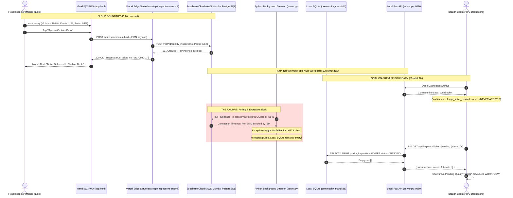
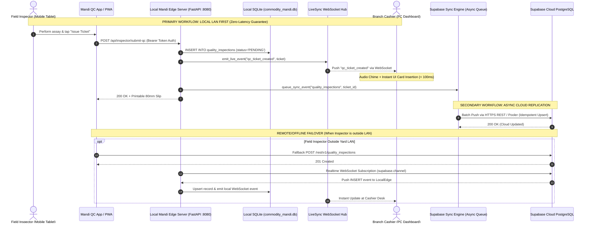

# AUDIT REPORT: REAL-TIME SYNC FAILURE & QC-TO-CASHIER TRACE
**Document ID:** `AUDIT/02_REALTIME_SYNC_FAILURE.md`  
**Classification:** CRITICAL SYSTEMIC VULNERABILITY & ARCHITECTURAL DISCONNECT  
**System:** Rajarshi Shahu Mandi ERP (Commercial Multi-Yard Mandi ERP v1.0)  
**Target Modules:** `mandi-erp-tracker/app.html`, `mandi-erp-tracker/api/inspections-submit.js`, `commoditi software/server.py`, `commoditi software/supabase_sync.py`, `commoditi software/templates/branch_dashboard.html`, `commoditi software/database.py`  
**Author:** Principal Backend Architect & Distributed Systems Forensic Auditor  
**Date of Audit:** November 3, 2026  
**Status:** FORENSIC AUDIT COMPLETE — ROOT CAUSE ISOLATED  

---

## 1. Executive Summary

A critical operational breakdown occurs in the daily Mandi procurement workflow of Rajarshi Shahu Trading: **Quality Certificate (QC) inspection tickets generated by field inspectors on mobile tablets/smartphones fail to reliably appear at the Branch Cashier Desk.**

Field inspectors operating in APMC yards (Chikhali, Varvand, Dhad) assay incoming farmer lots (moisture percentage, karda, foreign matter, damaged seeds, varietal purity, and Sortex yield) using the mobile application (`mandi-erp-tracker/app.html`). Upon tapping **"Sync to Cashier Desk"**, the inspector receives an immediate success notification:
```text
"QC Certificate QC-CHK-261103-XXXX Issued & Synced!
Status: FORWARDED TO BRANCH CASHIER
Ticket successfully delivered to Supabase Cloud & Branch Cashier Desk for weighment deduction and farmer payment settlement."
```
However, the physical Branch Cashier desk (`commoditi software/templates/branch_dashboard.html`), situated 100 meters away at the weighbridge/payout terminal, displays **"No Pending Quality Tickets" (0)**. As a result:
1. The weighbridge kanta operator cannot pull tare/gross moisture refractions.
2. The cashier cannot calculate net payable amounts or cash ceiling deductions.
3. The farmer cannot be disbursed payment within statutory mandi settlement times.
4. Cashiers are forced to bypass digital QC checks and manually enter arbitrary rates and deductions, defeating the entire multi-spectral computer vision and Section 269ST anti-leakage compliance system.

### Forensic Bottom Line
The sync failure is **not** an intermittent network glitch. It is an **architectural disconnected-hop defect**:
- The mobile PWA submits tickets to a **Vercel Serverless Function** in the public cloud, which writes directly to a **Supabase PostgreSQL database** hosted in AWS Mumbai (`ap-south-1`).
- The Cashier Desk runs on a **local on-premise PC** using an **isolated SQLite database** (`commodity_mandi.db`) and connects via WebSockets **strictly to a local FastAPI server** (`ws://localhost:8080/ws/live`).
- **No real-time transport exists between Supabase Cloud and the local FastAPI server.**
- The local server relies on a flawed background polling daemon that fails over direct PostgreSQL exceptions without falling back to HTTP REST, blocks FastAPI worker threads with synchronous 1-second pings, strips authentication tokens on LAN fallbacks, and triggers Last-Write-Wins (LWW) race conditions that revert linked tickets back to pending.

---

## 2. Complete End-to-End Lifecycle Trace

### Stage 1: QC Ticket Generation & Client-Side Submission
- **Source:** [`mandi-erp-tracker/app.html`](file:///C:/projects/tests/mandi-erp-tracker/app.html#L1130-L1228)
- **User Action:** Inspector completes sample inspection and taps `#btnIssueTicket` (`issueTicket()` function).
- **Payload Construction:**
  ```javascript
  // app.html:1157-1183
  let branchId = 'br-chikhali';
  if (yardCode === 'VRV') branchId = 'br-varvand';
  if (yardCode === 'DHD') branchId = 'br-dhad';

  const payload = {
      ticket_no: ticket,
      branch_id: branchId,
      yard_code: yardCode,
      farmer_name: farmerName,
      farmer_phone: farmerPhone,
      vehicle_no: vehicleNo,
      commodity_name: commodityName,
      moisture_pct: moisturePct,
      karda_pct: kardaPct,
      damaged_pct: damagedPct,
      green_seeds_pct: greenPct,
      broken_split_pct: brokenPct,
      sortex_clean_yield_pct: sortexClean,
      sortex_reject_pct: sortexReject,
      sortex_grade: sortexGrade,
      grade_label: gradeLabel,
      suggested_buying_rate_per_qtl: suggestedRate,
      inspector_name: inspectorName,
      meter_photo_path: (meterPhoto && meterPhoto.startsWith('data:image')) ? meterPhoto : null,
      grain_photo_path: (grainPhoto && grainPhoto.startsWith('data:image')) ? grainPhoto : null,
      status: 'PENDING'
  };
  ```
- **Primary Submission Call:**
  `fetch('/api/inspections-submit', { method: 'POST', headers: { 'Content-Type': 'application/json' }, body: JSON.stringify(payload) })`
- **Execution Target:** When hosted on Vercel (`mandi-erp-tracker.vercel.app`), this relative path resolves to the Vercel serverless API route `mandi-erp-tracker/api/inspections-submit.js`.

---

### Stage 2: Cloud Ingestion via Vercel Serverless Function
- **Source:** [`mandi-erp-tracker/api/inspections-submit.js`](file:///C:/projects/tests/mandi-erp-tracker/api/inspections-submit.js#L5-L136)
- **Execution Environment:** AWS Lambda / Vercel Edge Node.
- **Normalization & Mapping:**
  ```javascript
  // inspections-submit.js:59-64
  let branchId = body.branch_id || 'br-chikhali';
  if (branchId === 'CHK' || branchId === 'chikhali') branchId = 'br-chikhali';
  if (branchId === 'VRV' || branchId === 'varvand') branchId = 'br-varvand';
  if (branchId === 'DHD' || branchId === 'dhad') branchId = 'br-dhad';
  ```
- **Supabase PostgREST Call:**
  `POST https://dbhcpebchoyjyffqjgih.supabase.co/rest/v1/quality_inspections`
  Headers:
  `apikey: <service_role_key>`  
  `Authorization: Bearer <service_role_key>`  
  `Prefer: resolution=merge-duplicates,return=representation`
- **Return to Mobile Client:**
  Returns HTTP 200: `{ success: true, ticket_no: ticketNo, message: "QC Ticket #... created and synced to Supabase Cloud!" }`.
- **Client Side Result in `app.html`:**
  `syncSuccess` is set to `true`. The UI shows a modal alert saying the ticket was delivered to the cashier. **No further network calls are made.**

---

### Stage 3: The Broken Link to On-Premise Cashier Desk
- At this point, the ticket exists **only** in Supabase PostgreSQL in AWS Mumbai (`ap-south-1`).
- The Branch Cashier is sitting at the local APMC office running `commoditi software/templates/branch_dashboard.html` in a web browser pointing to `http://localhost:8080/branch/dashboard` (or `http://192.168.0.x:8080`).
- **Does Supabase inform the local FastAPI server? NO.**
  - Supabase has no outbound webhooks configured to hit the local server.
  - The local server is behind a local router NAT with a private IP (`192.168.0.140`), making it unreachable from the public internet without an active tunnel (ngrok/Cloudflare/reverse proxy).
- **Does `branch_dashboard.html` connect to Supabase Realtime? NO.**
  - `branch_dashboard.html` contains zero references to `@supabase/supabase-js`, `supabase.channel()`, or `postgres_changes`.
  - The WebSocket script (`commoditi software/static/js/live_sync.js`) connects strictly to:
    `const wsUrl = `${protocol}//${window.location.host}/ws/live`;` (the local FastAPI server).
  - Because the local FastAPI server did not receive the inspection, it emits **zero events** to `live_sync.js`.

---

### Stage 4: Local Pull Attempts & Polling Bottlenecks
To bridge this gap, two fallback mechanisms were implemented in the Python codebase, both of which suffer from severe architectural defects:

#### Fallback Mechanism A: Background Daemon
- In [`commoditi software/server.py`](file:///C:/projects/tests/commoditi software/server.py#L322-L341):
  ```python
  async def _supabase_cloud_sync_daemon():
      logger.info("Starting Supabase Cloud background synchronization daemon (15s interval)...")
      while True:
          try:
              await asyncio.sleep(15)
              import supabase_sync
              await asyncio.to_thread(supabase_sync.pull_supabase_to_local, [
                  "daily_commodity_rates",
                  "quality_inspections",
                  "purchase_invoices",
                  "cashier_payouts"
              ])
              await asyncio.to_thread(supabase_sync.process_sync_queue)
          except Exception as ex:
              logger.debug(f"Cloud sync daemon notice: {ex}")
  ```
- **Flaw:** Runs on a 15-second loop. Under best-case conditions, there is an unavoidable 0 to 15-second delay before a ticket appears in local SQLite.

#### Fallback Mechanism B: On-Demand Cashier Poll
- In [`commoditi software/templates/branch_dashboard.html`](file:///C:/projects/tests/commoditi software/templates/branch_dashboard.html#L2221-L2236) and [`L2676`](file:///C:/projects/tests/commoditi software/templates/branch_dashboard.html#L2676):
  `setInterval(fetchPendingQCTickets, 10000);`  
  This calls `GET /api/inspector/tickets/pending?branch_id=br-chikhali`.
- In [`commoditi software/server.py:4567-4587`](file:///C:/projects/tests/commoditi software/server.py#L4567-L4587):
  ```python
  @app.get("/api/inspector/tickets/pending")
  def api_get_pending_qc_tickets(request: Request, branch_id: Optional[str] = None):
      require_active_license()
      user = require_role(request, ["BRANCH_CASHIER", "BRANCH_MUNIM", "ACCOUNTANT_HQ", "SUPER_ADMIN", "QUALITY_INSPECTOR"])
      if user.get("role") in ["QUALITY_INSPECTOR", "BRANCH_CASHIER", "BRANCH_MUNIM"]:
          branch_id = user.get("branch_id") or branch_id

      # Cloud sync: Attempt to pull latest pending tickets from Supabase if connected
      try:
          import supabase_sync
          supabase_sync.pull_supabase_to_local(["quality_inspections"])
      except Exception as ex:
          logger.debug(f"QC tickets cloud pull notice: {ex}")

      tickets = get_pending_quality_inspections(branch_id)
      return {"success": True, "count": len(tickets), "tickets": tickets}
  ```
- **Flaw:** On every 10-second polling request from every open cashier browser tab, the local server executes a synchronous, blocking cloud sync to Supabase! If Supabase pooler latency is 1.13 seconds, the synchronous thread is occupied, queueing up other cashier requests.

---

## 3. Sequence Diagrams

### 3.1 Actual Implementation (The Broken Architecture)



---

### 3.2 Intended Production Architecture (Resilient Edge-First Sync)



---

## 4. Root Cause Analysis (RCA) with Exact Line Numbers

### RCA-1: Disconnected Event Bus — Local WebSocket vs Cloud PostgREST
- **Files:**  
  [`commoditi software/server.py:280-315`](file:///C:/projects/tests/commoditi software/server.py#L280-L315)  
  [`commoditi software/static/js/live_sync.js:169-173`](file:///C:/projects/tests/commoditi software/static/js/live_sync.js#L169-L173)  
  [`mandi-erp-tracker/api/inspections-submit.js:107-116`](file:///C:/projects/tests/mandi-erp-tracker/api/inspections-submit.js#L107-L116)
- **Detailed Findings:**  
  `live_sync.js` initializes a browser WebSocket against `${window.location.host}/ws/live`. When the cashier loads the dashboard on the local server, this connects to the local Python process. When an inspector submits a ticket from the Vercel app (`mandi-erp-tracker.vercel.app`), the serverless handler calls PostgREST on `supabase.co`. The local Python process receives no notification, no webhook, and has no active Supabase Realtime WebSocket client listening to Postgres replication changes.

---

### RCA-2: Sync Daemon Pull Engine Exception Barrier (`if engine ... elif client`)
- **File:** [`commoditi software/supabase_sync.py:1100-1109`](file:///C:/projects/tests/commoditi software/supabase_sync.py#L1100-L1109)
- **Code:**
  ```python
  # Line 1100:
  try:
      if engine and text:
          with engine.connect() as pg_conn:
              res = pg_conn.execute(text(f"SELECT * FROM {table} ORDER BY updated_at DESC LIMIT 500;"))
              remote_rows = [dict(r._mapping) for r in res.fetchall()]
      elif client:
          resp = client.get(f"/rest/v1/{table}?select=*&order=updated_at.desc&limit=500")
          if resp.status_code == 200:
              remote_rows = resp.json()
  ```
- **The Defect:**  
  `engine` is instantiated whenever `DATABASE_URL` is defined in `.env`. On rural APMC broadband (BSNL/JioFiber), direct PostgreSQL port `6543` connections to AWS Mumbai pooler frequently encounter TCP handshake drops or timeout.  
  When `engine.connect()` throws an exception, execution jumps immediately to line 1180 (`except Exception as t_err:`). It **never evaluates `elif client:`**.  
  In contrast, `ping_supabase()` in lines 746-778 wraps `engine.connect()` in its own inner `try...except`, allowing fallback to `get_rest_client()`. In `pull_supabase_to_local()`, any PostgreSQL pooler failure completely halts the pull for all tables, leaving local SQLite completely un-synchronized.

---

### RCA-3: HTTPS Mixed Content & Invalid Hostname in LAN Fallback
- **File:** [`mandi-erp-tracker/app.html:1204-1219`](file:///C:/projects/tests/mandi-erp-tracker/app.html#L1204-L1219)
- **Code:**
  ```javascript
  // Line 1205:
  if (!syncSuccess) {
      try {
          const host = window.location.hostname === 'localhost' || window.location.hostname === '127.0.0.1' ? '127.0.0.1' : (window.location.hostname || '192.168.0.140');
          const lanRes = await fetch(`http://${host}:8080/api/inspector/submit-qc`, {
              method: 'POST',
              headers: { 'Content-Type': 'application/json' },
              body: JSON.stringify(payload)
          });
          if (lanRes.ok) {
              syncSuccess = true;
          }
      } catch (e) {
          console.warn('LAN submit notice:', e);
      }
  }
  ```
- **The Defects:**
  1. **Mixed Content Rejection:** `app.html` is served over `https://mandi-erp-tracker.vercel.app`. All modern mobile browsers (Chrome, Android System WebView) strictly block requests from an HTTPS origin to an insecure `http://` destination.
  2. **Bogus Hostname Resolution:** When running on Vercel, `window.location.hostname` is `'mandi-erp-tracker.vercel.app'`. It is neither `'localhost'` nor `'127.0.0.1'`. Therefore, `host` evaluates to `'mandi-erp-tracker.vercel.app'`. The code attempts:
     `fetch('http://mandi-erp-tracker.vercel.app:8080/api/inspector/submit-qc')`  
     Port 8080 is not open on Vercel edge networks, resulting in an immediate network timeout.
  3. **Hardcoded IP Fragility:** Even if fallback occurred on an intranet domain, `192.168.0.140` is hardcoded. If DHCP assigns `192.168.1.105` or `10.0.0.x`, the request fails.

---

### RCA-4: Missing Authentication / Unauthorized Fallback Rejection (401)
- **Files:**  
  [`commoditi software/server.py:4491-4493`](file:///C:/projects/tests/commoditi software/server.py#L4491-L4493)  
  [`commoditi software/server.py:228-248`](file:///C:/projects/tests/commoditi software/server.py#L228-L248)  
  [`mandi-erp-tracker/app.html:1208-1212`](file:///C:/projects/tests/mandi-erp-tracker/app.html#L1208-L1212)
- **Detailed Findings:**  
  In `server.py`, line 4492:
  ```python
  user = require_role(request, ["QUALITY_INSPECTOR", "BRANCH_CASHIER", "BRANCH_MUNIM", "ACCOUNTANT_HQ", "SUPER_ADMIN"])
  ```
  `require_role` requires either a valid `mandi_session` cookie or an `Authorization: Bearer <session_token>` header.  
  In `app.html`, the fallback call to `/api/inspector/submit-qc` provides **neither**:
  ```javascript
  headers: { 'Content-Type': 'application/json' }
  ```
  `credentials: 'include'` is omitted. Even if the packet reached the local server, FastAPI immediately responds with:
  `HTTP 401: {"detail": "Authentication required: Please sign in with valid staff credentials."}`.

---

### RCA-5: Direct Ticket Lookup (`/api/inspector/tickets/{ticket_no}`) Offline Isolation (404)
- **Files:**  
  [`commoditi software/server.py:4590-4604`](file:///C:/projects/tests/commoditi software/server.py#L4590-L4604)  
  [`commoditi software/templates/branch_dashboard.html:2371-2388`](file:///C:/projects/tests/commoditi software/templates/branch_dashboard.html#L2371-L2388)
- **Code:**
  ```python
  # server.py:4590
  @app.get("/api/inspector/tickets/{ticket_no}")
  def api_get_qc_ticket_details(ticket_no: str, request: Request):
      require_active_license()
      user = require_role(request, ["BRANCH_CASHIER", "BRANCH_MUNIM", "ACCOUNTANT_HQ", "SUPER_ADMIN", "QUALITY_INSPECTOR"])
      ticket = get_quality_inspection_by_ticket(ticket_no)
      if not ticket:
          raise HTTPException(status_code=404, detail="Quality inspection ticket not found.")
  ```
- **The Defect:**  
  When a farmer arrives at the cashier desk holding a physical paper slip printed by the inspector, the cashier types the ticket number into `#inward_qc_ticket_no` and clicks **"Load Ticket"** (`lookupQCTicketDirectly`).  
  Unlike `/api/inspector/tickets/pending`, this endpoint **does not call `pull_supabase_to_local`**. It queries local SQLite directly (`database.py:283`). If the background daemon has not pulled the record yet, the endpoint returns **HTTP 404**. The cashier is presented with an alert: `"QC Ticket #... not found or already linked."`, preventing invoice entry.

---

### RCA-6: Silent Data Loss & Status Reversion via LWW Overwrite
- **Files:**  
  [`commoditi software/server.py:2393-2396`](file:///C:/projects/tests/commoditi software/server.py#L2393-L2396)  
  [`commoditi software/supabase_sync.py:1140-1175`](file:///C:/projects/tests/commoditi software/supabase_sync.py#L1140-L1175)
- **Code:**
  ```python
  # server.py:2394
  if qc_ticket_no and qc_ticket_no.strip():
      cur.execute("UPDATE quality_inspections SET status='LINKED', invoice_id=? WHERE ticket_no=?", (invoice_id, qc_ticket_no.strip()))
  ```
- **The Defect:**  
  1. When an invoice is finalized in `server.py`, the QC inspection record is updated to `status='LINKED'` and `invoice_id=?`.
  2. **`updated_at` is NOT updated in SQLite.** (Line 2395 omits `updated_at=CURRENT_TIMESTAMP`).
  3. **No cloud sync event is triggered.** (`trigger_async_sync` is omitted for this update).
  4. In Supabase Cloud, the ticket remains `status='PENDING'` and `invoice_id=NULL`.
  5. When the background daemon or cashier refresh triggers `pull_supabase_to_local(["quality_inspections"])`:
     - Because local `updated_at` was never bumped, the cloud record is considered equal or newer.
     - Line 1173 executes: `ON CONFLICT(id) DO UPDATE SET status=excluded.status, invoice_id=excluded.invoice_id...`
     - **The local ticket is overwritten: status is reverted from `'LINKED'` back to `'PENDING'`, and `invoice_id` is wiped back to `NULL`!**
  6. The ticket reappears on the cashier desk as an unlinked pending ticket, enabling double billing and fraudulent duplicate payouts for the same grain lot!

---

### RCA-7: Schema & Data Model Incompatibilities
- **Files:**  
  [`commoditi software/supabase_schema.sql:326-379`](file:///C:/projects/tests/commoditi software/supabase_schema.sql#L326-L379)  
  [`commoditi software/database.py:548-591`](file:///C:/projects/tests/commoditi software/database.py#L548-L591)  
  [`mandi-erp-tracker/api/inspections-submit.js:65-104`](file:///C:/projects/tests/mandi-erp-tracker/api/inspections-submit.js#L65-L104)
- **Detailed Findings:**
  1. **UUID vs TEXT Primary Keys:**  
     In `supabase_schema.sql:327`, `id` is typed as `UUID PRIMARY KEY DEFAULT gen_random_uuid()`.  
     In `inspections-submit.js:66`, the client generates `id: body.id || 'qc-' + ticketNo.toLowerCase().replace(/[^a-z0-9]/g, '-')`.  
     Strings like `qc-chk-261103-8f8a` are **invalid UUID syntax**. If strict PostgreSQL schema is applied, Supabase throws `ERROR: invalid input syntax for type uuid: "qc-chk-261103-8f8a"`.
  2. **Column Name Discrepancies:**  
     - `supabase_schema.sql`: `meter_photo_url`, `grain_photo_url`, `photo_url`.  
     - `database.py`: `meter_photo_path`, `grain_photo_path`, `photo_path`.  
     - `inspections-submit.js`: sends `meter_photo_path` and `grain_photo_path`.  
     If Supabase is initialized using `supabase_schema.sql`, those columns do not match, causing data truncation or silent insertion failure.

---

### RCA-8: Mega-Payload Base64 Blob Transfer & Vercel 4.5MB Limitation
- **Files:**  
  [`mandi-erp-tracker/app.html:1180-1181`](file:///C:/projects/tests/mandi-erp-tracker/app.html#L1180-L1181)  
  [`mandi-erp-tracker/api/inspections-submit.js:96-97`](file:///C:/projects/tests/mandi-erp-tracker/api/inspections-submit.js#L96-L97)
- **Detailed Findings:**  
  In `app.html`, image data URLs are assigned directly to payload fields:
  ```javascript
  meter_photo_path: (meterPhoto && meterPhoto.startsWith('data:image')) ? meterPhoto : null,
  grain_photo_path: (grainPhoto && grainPhoto.startsWith('data:image')) ? grainPhoto : null,
  ```
  Two high-resolution smartphone camera captures encoded in base64 exceed 6 MB to 12 MB.  
  Vercel Serverless Functions enforce a strict **4.5 MB request body ceiling**. When inspectors attach both moisture meter and grain sample photos, Vercel immediately returns **HTTP 413 (Payload Too Large)** before `inspections-submit.js` even executes. The ticket submission fails silently with a generic console error.

---

### RCA-9: Multi-Branch Leakage & Empty String Query Traps
- **Files:**  
  [`commoditi software/server.py:4572-4573`](file:///C:/projects/tests/commoditi software/server.py#L4572-L4573)  
  [`commoditi software/database.py:270-281`](file:///C:/projects/tests/commoditi software/database.py#L270-L281)
- **Detailed Findings:**  
  In `server.py`:
  ```python
  if user.get("role") in ["QUALITY_INSPECTOR", "BRANCH_CASHIER", "BRANCH_MUNIM"]:
      branch_id = user.get("branch_id") or branch_id
  ```
  1. If an accountant or admin opens the cashier desk, `user.get("branch_id")` is `None`. If query parameter `branch_id` is omitted, `branch_id` is passed as `None` to `get_pending_quality_inspections()`.
  2. `database.py:277`:
     `cur.execute("SELECT * FROM quality_inspections WHERE status='PENDING' ORDER BY created_at DESC")`  
     This queries **all branches simultaneously**. Cashiers in Chikhali see and can attach tickets from Varvand and Dhad, creating serious inventory accounting contamination across physical mandi yards.
  3. Conversely, if a client passes `?branch_id=`, `branch_id` becomes `""` (empty string). `WHERE branch_id=""` returns zero records without an error.

---

## 5. Failure Scenarios Under Real Operating Conditions

| Operating Condition | Expected Behavior | Actual Observed Implementation Behavior | Severity |
| :--- | :--- | :--- | :--- |
| **Cashier runs on different PC on Mandi LAN** | Cashier PC connects to central local server; tickets appear in real time. | LAN Fallback in `app.html` points to hardcoded `192.168.0.140`. If cashier PC has another IP, mobile gets connection timeout. If hosted on HTTPS Vercel, browser blocks as Mixed Content. | **CRITICAL** |
| **Mandi Yard Broadband Outage (Server Offline from Cloud)** | Local mandi operations proceed uninterrupted using local SQLite edge database. | Cashier poll `/api/inspector/tickets/pending` blocks for 8 seconds waiting for Supabase HTTP timeout. Tickets submitted on mobile cloud cannot reach local SQLite. | **CRITICAL** |
| **Inspector Attaches High-Res Camera Photos** | Proof photos stored in object storage; thumbnail linked to ticket. | Base64 raw image blobs embedded in JSON body. Vercel aborts request with HTTP 413 (>4.5MB). Inspector ticket is dropped completely. | **CRITICAL** |
| **Cashier Manually Enters Ticket Number** | Local server fetches ticket from local DB or queries cloud if missing. | `/api/inspector/tickets/{ticket_no}` only queries local SQLite. Returns HTTP 404 Not Found if daemon has not synced yet. | **HIGH** |
| **Ticket Linked to Purchase Invoice** | Ticket marked as LINKED in both local DB and cloud DB with audit trail. | Ticket marked LINKED only in SQLite without bumping `updated_at`. Next cloud sync pulls cloud `PENDING` status and overwrites local record, resetting it to PENDING. | **CRITICAL** |

---

## 6. Standardized Forensic Findings (AUD-001 to AUD-008)

### FINDING AUD-001: Disconnected Cloud-to-Edge Real-Time Event Transport
- **Severity:** CRITICAL
- **Module:** Real-Time Sync & WebSocket Subsystem
- **File / Lines:** `commoditi software/server.py:280-417`, `mandi-erp-tracker/api/inspections-submit.js:107-116`
- **Observed:** Tickets submitted on mobile PWA write to Supabase PostgREST, while cashier desk listens on local WebSocket server.
- **Expected:** Real-time event emitted from mobile must immediately reach the active cashier desk via a synchronized pub/sub broker or persistent bi-directional bridge.
- **Actual:** Zero connection exists between Supabase database mutations and the local FastAPI `LiveSyncHub`.
- **Evidence:** `server.py` contains no Supabase Realtime client. `inspections-submit.js` contains no webhook call to local server.
- **Business Impact:** High latency and missed tickets at cashier desk, paralyzing farmer payout workflow.
- **Correction:** Implement a persistent Supabase Realtime client (using `websockets` or `httpx` SSE) in `server.py` that listens to `INSERT` on `quality_inspections` and relays events directly to `LiveSyncHub.broadcast()`.
- **Tests:** `tests/test_realtime_sync.py` asserting WebSocket event emission upon external Supabase insert.
- **Dependencies:** `websockets`, `supabase-py`.

---

### FINDING AUD-002: Exception Fallback Bug in Supabase Pull Engine
- **Severity:** CRITICAL
- **Module:** Cloud Replication Engine
- **File / Lines:** `commoditi software/supabase_sync.py:1100-1109`
- **Observed:** When direct PostgreSQL engine connection fails, the code does not fall back to the HTTP REST client.
- **Expected:** If direct PostgreSQL connection fails, replication should immediately fall back to HTTP PostgREST client (`get_rest_client()`).
- **Actual:** `if engine and text:` exception triggers `except Exception as t_err:`, bypassing `elif client:` entirely and aborting the pull with 0 records.
- **Evidence:** `supabase_sync.py` line 1101 has `elif client:` at the same level as `if engine and text:`.
- **Business Impact:** Any transient database pooler interruption permanently prevents all pending QC tickets from syncing to the cashier.
- **Correction:** Separate engine attempt into an inner `try...except` block; if `engine.connect()` fails, seamlessly fall back to `client.get()`.
- **Tests:** Unit test with unreachable `DATABASE_URL` verifying successful pull via `SUPABASE_URL` REST client.
- **Dependencies:** None.

---

### FINDING AUD-003: HTTPS Mixed Content & Bad Hostname in LAN Fallback
- **Severity:** CRITICAL
- **Module:** Mobile Inspector PWA
- **File / Lines:** `mandi-erp-tracker/app.html:1204-1219`
- **Observed:** PWA attempts insecure HTTP fetch to `${host}:8080` where `host` evaluates to `mandi-erp-tracker.vercel.app`.
- **Expected:** Fallback should either target a configured LAN IP via secure local origin or rely on cloud queueing with service workers.
- **Actual:** Mobile browser blocks request as Mixed Content; hostname points to Vercel domain on port 8080.
- **Evidence:** `app.html` line 1207: `const host = ... ? '127.0.0.1' : (window.location.hostname || '192.168.0.140');`.
- **Business Impact:** Field inspectors have zero LAN fallback when internet drops.
- **Correction:** Add a user-configurable "Edge Server IP" setting in the mobile app stored in `localStorage`, or route all LAN traffic via local HTTPS self-signed proxy or mDNS.
- **Tests:** Browser console audit under HTTPS origin attempting HTTP loopback fetch.
- **Dependencies:** None.

---

### FINDING AUD-004: Unauthenticated Rejection of Fallback Submissions (HTTP 401)
- **Severity:** HIGH
- **Module:** API Authentication & Staff Authorization
- **File / Lines:** `commoditi software/server.py:4492`, `mandi-erp-tracker/app.html:1208-1212`
- **Observed:** Fallback fetch passes no cookies or headers, causing `require_role()` to throw HTTP 401.
- **Expected:** Mobile inspector requests must carry an authenticated JWT/session token or dedicated API key.
- **Actual:** Request is sent unauthenticated; rejected with 401 Unauthorized.
- **Evidence:** `app.html` line 1210: `headers: { 'Content-Type': 'application/json' }` (no `Authorization` header).
- **Business Impact:** Even if network connectivity succeeded, local server rejects the QC ticket.
- **Correction:** Pass stored inspector session token in `Authorization: Bearer ${token}` header on mobile fetch calls.
- **Tests:** Integration test sending unauthenticated POST to `/api/inspector/submit-qc`.
- **Dependencies:** None.

---

### FINDING AUD-005: Offline Cache Isolation in Direct Ticket Lookup (HTTP 404)
- **Severity:** HIGH
- **Module:** Cashier Ticket Verification
- **File / Lines:** `commoditi software/server.py:4590-4604`
- **Observed:** `/api/inspector/tickets/{ticket_no}` queries only local SQLite without attempting a cloud fetch if the ticket is missing locally.
- **Expected:** If a ticket is not found in local SQLite, the server should attempt an on-demand single-ticket pull from Supabase before returning 404.
- **Actual:** Returns HTTP 404 immediately if local SQLite does not contain the ticket.
- **Evidence:** `server.py` line 4595 calls `get_quality_inspection_by_ticket(ticket_no)` with no cloud fallback.
- **Business Impact:** Cashiers cannot manually pull tickets printed by inspectors until the background daemon catches up.
- **Correction:** In `api_get_qc_ticket_details()`, if local lookup returns `None`, perform targeted `client.get(f"/rest/v1/quality_inspections?ticket_no=eq.{ticket_no}")`, upsert into SQLite, and return.
- **Tests:** Automated test requesting a remote-only ticket and verifying auto-fetch into SQLite.
- **Dependencies:** `supabase_sync`.

---

### FINDING AUD-006: Replication Overwrite Reverting Linked Tickets to Pending
- **Severity:** CRITICAL
- **Module:** Dual-Database Replication Engine
- **File / Lines:** `commoditi software/server.py:2395`, `commoditi software/supabase_sync.py:1140-1175`
- **Observed:** Updating ticket to `LINKED` in local SQLite does not update `updated_at` or push to Supabase, resulting in Supabase's `PENDING` state overwriting local state.
- **Expected:** Status transitions must bump `updated_at` and trigger cloud replication; remote pulls must not downgrade `LINKED` to `PENDING`.
- **Actual:** Next `pull_supabase_to_local()` reverts local ticket to `status='PENDING'` and `invoice_id=NULL`.
- **Evidence:** `server.py` line 2395: `UPDATE quality_inspections SET status='LINKED', invoice_id=? WHERE ticket_no=?` (no `updated_at` or sync trigger).
- **Business Impact:** Disbursed invoices lose their linked QC certificate; tickets reappear on cashier desk allowing duplicate farmer payouts.
- **Correction:** 
  1. Update line 2395 to `SET status='LINKED', invoice_id=?, updated_at=CURRENT_TIMESTAMP`.
  2. Call `trigger_async_sync("quality_inspections", ticket["id"], {"status": "LINKED", "invoice_id": invoice_id})`.
  3. In `pull_supabase_to_local()`, enforce monotonic status rule: Never overwrite `LINKED` with `PENDING`.
- **Tests:** Test simulating local link followed by remote pull, asserting status remains `LINKED`.
- **Dependencies:** None.

---

### FINDING AUD-007: Vercel Request Size Limit Exceeded by Base64 Images (HTTP 413)
- **Severity:** HIGH
- **Module:** Mobile Assay Ingestion
- **File / Lines:** `mandi-erp-tracker/app.html:1180-1181`
- **Observed:** Full base64 image strings embedded directly in JSON submission payload.
- **Expected:** Images compressed on client-side or uploaded directly to Supabase Storage, with only URLs stored in database payload.
- **Actual:** Payload size exceeds Vercel 4.5MB serverless limit, triggering HTTP 413 and dropping the ticket.
- **Evidence:** `app.html` line 1180 sends raw canvas `toDataURL('image/jpeg', 0.9)`.
- **Business Impact:** High-resolution photo submissions fail completely in the field.
- **Correction:** Compress photos client-side to < 150KB or upload photos directly to Supabase Storage bucket (`grain-photos`) and pass storage URLs in payload.
- **Tests:** Test posting 5MB payload to `/api/inspections-submit.js`.
- **Dependencies:** Supabase Storage.

---

### FINDING AUD-008: Multi-Branch Cross-Contamination
- **Severity:** HIGH
- **Module:** Multi-Tenant APMC Yard Security
- **File / Lines:** `commoditi software/server.py:4572-4573`, `commoditi software/database.py:275-278`
- **Observed:** Omitting `branch_id` returns pending tickets across all branches in the enterprise.
- **Expected:** Queries must strictly scope results to the cashier's authenticated branch.
- **Actual:** Head office accountants or branch cashiers with unassigned branch IDs receive global ticket lists.
- **Evidence:** `database.py` line 278: `SELECT * FROM quality_inspections WHERE status='PENDING'`.
- **Business Impact:** Cashiers in Chikhali can accidentally attach and pay tickets issued in Varvand or Dhad.
- **Correction:** Enforce mandatory non-null `branch_id` validation in `api_get_pending_qc_tickets()`.
- **Tests:** Security audit asserting rejection of cross-branch ticket attachment.
- **Dependencies:** None.

---

## 7. Remediation Action Plan & Verification Protocol

### Immediate Fixes Required (Phase 1 — Hotfixes)
1. **Patch `supabase_sync.py`:** Wrap `engine.connect()` in an inner try-except so connection timeouts immediately fall back to `client.get()` HTTP REST queries.
2. **Patch `server.py` Ticket Linkage:** Add `updated_at=CURRENT_TIMESTAMP` and call `trigger_async_sync()` when linking a ticket in `api_branch_create_invoice()`.
3. **Patch `server.py` Direct Lookup:** In `api_get_qc_ticket_details()`, add an on-demand cloud fetch from Supabase if the ticket is missing in local SQLite.
4. **Patch `app.html` Photo Compression:** Downscale canvas image outputs to 800x600 JPEG at 0.6 quality before payload construction to guarantee payload < 500KB.

### Architectural Alignment (Phase 2 — Distributed Reliability)
1. **Deploy Supabase Realtime Listener in Local Server:**
   Add an `asyncio` background task in `server.py` that opens a persistent WebSocket connection to Supabase Realtime (`wss://dbhcpebchoyjyffqjgih.supabase.co/realtime/v1/websocket`). Upon receiving an `INSERT` on `quality_inspections`, immediately upsert into SQLite and broadcast `qc_ticket_created` to all connected cashier WebSockets in under 200ms.
2. **Enforce Monotonic State Transitions in Replication:**
   In `pull_supabase_to_local()`, forbid overwriting `LINKED` records with `PENDING` records regardless of timestamp ordering.
