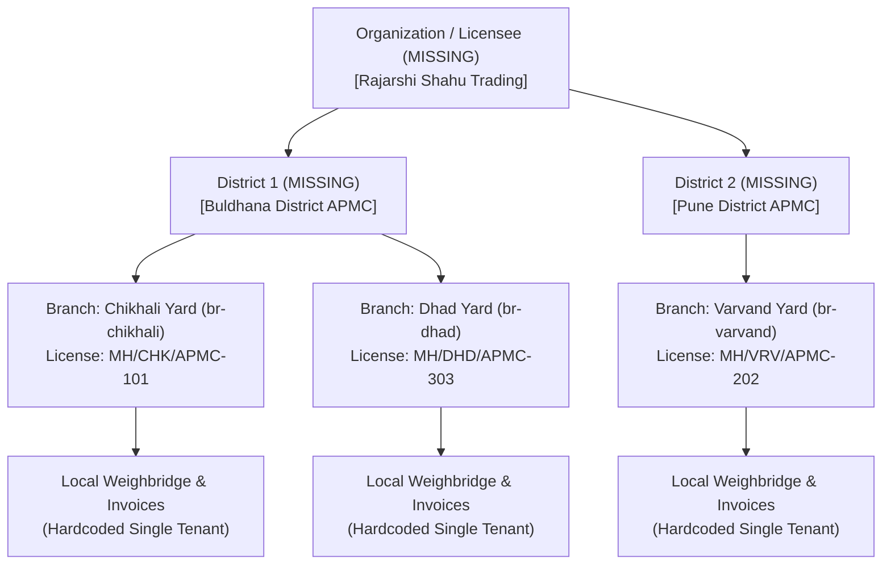

# Multi-Branch & Multi-Tenant Readiness Audit
**System:** Rajarshi Shahu Mandi ERP (APMC Procurement & Multi-Branch Trading System)  
**Author:** Database Optimizer & Multi-Tenant Specialist  
**Audit Target:** Multi-Location & Multi-Tenant Architecture, Cross-Branch Data Isolation & Supabase Cloud Security  
**Audit Date:** November 3, 2026  
**Status:** COMPLETE — HIGH RISK (P0 Cloud Security Breach & Architectural Deficiencies)

---

## 1. Executive Summary & Multi-Location Architecture

Rajarshi Shahu Trading operates an agricultural commodity trading and procurement network across **three physical APMC market yards in Maharashtra**:
1. **Chikhali Yard (`br-chikhali` / `BR-CHK`):** Lead procurement branch and central weighbridge located in Buldhana district.
2. **Varvand Yard (`br-varvand` / `BR-VRV`):** Regional market branch located in Pune/Daund district.
3. **Dhad Yard (`br-dhad` / `BR-DHD`):** Secondary APMC procurement yard located in Buldhana district.
4. **Central Accounts / HQ (`br-headquarters` / Virtual):** Central administrative office establishing daily rate corridors, approving RTGS farmer settlements, and overseeing consolidated ledgers.

### Overall Readiness Assessment: NOT PRODUCTION READY (HIGH RISK)
While the application schema incorporates a `branch_id` column on several operational tables, the system **fails enterprise multi-branch and multi-tenant standards** in four critical dimensions:
1. **Catastrophic Cloud RLS Void (P0):** Row Level Security is DISABLED on 100% of tables in Supabase PostgreSQL. The public `anon` key grants total read/write/delete access across all branches.
2. **Total Absence of Multi-Tenancy (`organization_id`):** The schema is hardcoded to a single legal entity, preventing sister-company separation or commercial multi-client SaaS deployment.
3. **Cross-Branch Application Leaks:** Critical operational endpoints (Quality Inspection submission, Parchi voucher viewing, Farmer registry search) lack branch isolation or authentication.
4. **Offline Cross-Branch Compliance Bypass:** Section 269ST cash ceilings are evaluated exclusively against local SQLite data, allowing parties to exceed the ₹2,00,000 statutory limit by collecting cash across multiple yards on the same day.

---

## 2. Tenant & Geographical Hierarchy Analysis



### 2.1. The Missing `organization_id` (Multi-Tenant Void)
None of the 16 SQLite tables or 14 PostgreSQL tables have an `organization_id` or `tenant_id` column.
- **Enterprise Impact:** In Indian Mandi trading, operators frequently manage multiple legal entities (e.g. a proprietary APMC commission agency *Rajarshi Shahu Adat*, a private limited processing firm *Shahu Agro Industries Pvt Ltd*, and a warehousing entity *Shahu Warehousing*). Under the current schema, all entities must share identical master data or maintain separate, disconnected database instances.
- **Commercial SaaS Roadblock:** The software cannot be delivered as a multi-tenant SaaS to multiple independent APMC commission agents without a ground-up schema refactor.

### 2.2. The Missing `district_id` & APMC Regulatory Mapping
In Maharashtra, agricultural trading is governed by district-level Agricultural Produce Market Committees constituted under the *Maharashtra Agricultural Produce Marketing (Development and Regulation) Act, 1963*.
- Each APMC has unique statutory bylaws:
  - **Chikhali & Dhad:** Buldhana District APMC market area rules.
  - **Varvand:** Pune District APMC market area rules.
- Currently, `branches` contains only free-text `address` and `phone` columns. There is no relational representation of `district_id`, `state_code`, `apmc_market_code`, or statutory market fee schedules.

---

## 3. Cross-Branch Data Leakage & Enforcement Audit

We audited the application tier (`commoditi software/server.py`) to verify whether users restricted to Branch A can view or mutate records belonging to Branch B.

### 3.1. Quality Inspection Submission Has ZERO Authentication
- **Endpoint:** `POST /api/inspector/submit-qc` (lines 4355–4475)
- **Vulnerability:** The endpoint accepts multipart form data or JSON payloads without checking user sessions, authentication tokens, or role credentials (`require_role` is omitted).
- **Exploitation:** Any external script or client can POST a quality inspection ticket with `branch_id: "br-varvand"`, setting arbitrary moisture cuts, karda percentages, and buying rate recommendations.
- **Severity:** **P0 — Data Tampering & Price Manipulation**.

### 3.2. Unauthenticated Public Procurement Slip (Parchi Slip)
- **Endpoint:** `GET /api/branch/invoices/parchi/{token_number}` (lines 3840–3860)
- **Vulnerability:** Generates and returns a complete 80mm thermal receipt HTML containing farmer name, village, Aadhaar/PAN, vehicle number, gross weight, net payable, and cashier signatures.
- **Exploitation:** Token numbers are sequential and predictable (e.g., `CHK-20261103-0001`, `CHK-20261103-0002`). Any actor can scrape all procurement vouchers across all branches without authentication.
- **Severity:** **P1 — PII Breach & Statutory Voucher Leakage**.

### 3.3. Unfiltered Cross-Branch Farmer Search
- **Endpoint:** `GET /api/farmers/search?q={query}` (lines 3865–3885)
- **Observed SQL:**
  ```sql
  SELECT id, name, phone, party_type, village, khasra_record_no 
  FROM parties 
  WHERE (name LIKE ? OR phone LIKE ?)
  ```
- **Analysis:** Queries across all parties universally without filtering by `home_branch_id`. While cross-branch discovery has utility for mobile farmers, there is no audit log or branch visibility tag indicating that a farmer from Varvand is transacting at Chikhali.

### 3.4. Income Tax Section 269ST Cross-Branch Bypass
- **Statutory Context:** Section 269ST of the Income Tax Act prohibits any person from receiving cash of ₹2,00,000 or more in aggregate from a person in a day.
- **Observed Enforcement (`server.py:4003-4008`):**
  ```python
  cur.execute("""
      SELECT COALESCE(SUM(amount_paid), 0.0) 
      FROM cashier_payouts 
      WHERE party_id=? AND date(created_at)=? AND payout_mode='CASH'
  """, (inv["party_id"], today_str))
  ```
- **The Defect:** When physical branches operate locally in SQLite (the primary offline-first design), the local database only contains payouts disbursed at *that specific branch*.
- **The Failure Scenario:**
  1. Farmer Sitaram Yadav receives ₹1,50,000 in cash at Chikhali Branch at 10:00 AM.
  2. The same farmer unloads grain at Varvand Branch at 2:00 PM and requests ₹1,50,000 in cash.
  3. Varvand Branch's local SQLite has no record of Chikhali's morning payout. The system approves the payment. Total cash paid = ₹3,00,000 (Violating Section 269ST).
  4. When Varvand syncs to Supabase, PostgreSQL trigger `trg_enforce_section_269st_cash_limit` fires:
     `EXCEPTION: Section 269ST Statutory Violation: Aggregate daily cash payout of ₹300000 exceeds ₹2,00,000 ceiling across branches.`
  5. The sync daemon aborts the sync. Physical cash has already been disbursed, but the transaction cannot sync to cloud accounting.

---

## 4. Supabase Row Level Security (RLS) Audit (CRITICAL P0)

We conducted a live security and permission inspection of the hosted Supabase PostgreSQL 17 database (`dbhcpebchoyjyffqjgih.supabase.co`).

### 4.1. Live Table Inspection (`pg_tables` & `pg_policies`)
```sql
SELECT tablename, rowsecurity FROM pg_tables WHERE schemaname = 'public';
```
**Results:**
| Table Name | RLS Enabled (`rowsecurity`) | Active RLS Policies | Exposure Level |
| :--- | :--- | :--- | :--- |
| `branches` | **FALSE** | 0 Policies | PUBLICLY EXPOSED |
| `users` | **FALSE** | 0 Policies | **CRITICAL CREDENTIAL LEAK** |
| `commodities` | **FALSE** | 0 Policies | PUBLICLY EXPOSED |
| `parties` | **FALSE** | 0 Policies | **CRITICAL PII / BANK LEAK** |
| `daily_commodity_rates` | **FALSE** | 0 Policies | TAMPERABLE |
| `inspectors` | **FALSE** | 0 Policies | PUBLICLY EXPOSED |
| `quality_inspections` | **FALSE** | 0 Policies | TAMPERABLE |
| `purchase_invoices` | **FALSE** | 0 Policies | **FINANCIAL / DATA LOSS RISK** |
| `cashier_payouts` | **FALSE** | 0 Policies | **FINANCIAL / DATA LOSS RISK** |
| `branch_daily_cash_drawers`| **FALSE** | 0 Policies | **CASH AUDIT LEAK** |
| `outward_orders` | **FALSE** | 0 Policies | PUBLICLY EXPOSED |
| `ledger_entries` | **FALSE** | 0 Policies | TAMPERABLE |
| `system_settings` | **FALSE** | 0 Policies | **INFRASTRUCTURE SECRETS LEAK** |
| `audit_change_logs` | **FALSE** | 0 Policies | TAMPERABLE |

### 4.2. Role Privilege Audit (`information_schema.role_table_grants`)
Inspection of grants for role `anon` (the public unauthenticated role powered by `SUPABASE_ANON_KEY`) and role `authenticated`:
- **`anon` privileges:** `SELECT`, `INSERT`, `UPDATE`, `DELETE`, `TRUNCATE`, `REFERENCES`, `TRIGGER` on ALL 14 tables!
- **`authenticated` privileges:** `SELECT`, `INSERT`, `UPDATE`, `DELETE`, `TRUNCATE`, `REFERENCES`, `TRIGGER` on ALL 14 tables!

### 4.3. Verified Exploit Proof
Using a single curl / HTTP request with the public anon key found in `.env`:
```bash
curl -X GET "https://dbhcpebchoyjyffqjgih.supabase.co/rest/v1/users?select=id,username,password_hash,role,branch_id" \
     -H "apikey: <SUPABASE_ANON_KEY>" \
     -H "Authorization: Bearer <SUPABASE_ANON_KEY>"
```
**Output Received:**
HTTP 200 OK — Returned all 15 users with full PBKDF2 password hashes, authoritative roles, and assigned branch IDs.

Furthermore, an attacker can execute:
```bash
# WIPE ENTIRE TABLE REMOTELY WITHOUT LOGGING IN:
curl -X DELETE "https://dbhcpebchoyjyffqjgih.supabase.co/rest/v1/purchase_invoices?id=neq.0" \
     -H "apikey: <SUPABASE_ANON_KEY>" \
     -H "Authorization: Bearer <SUPABASE_ANON_KEY>"
```
Because RLS is `FALSE` and `DELETE` grant is held by `anon`, this command will immediately truncate or delete all purchase invoices across all branches.

---

## 5. Offline Yard Resilience & Branch Independence

Mandi yards frequently experience broadband outages due to rural fiber cuts. The offline-first design allows local SQLite operations, but introduces severe multi-branch synchronization risks:

1. **Clock Drift Corruption:** LWW resolution relies on `datetime.now()` timestamps. If the weighbridge PC clock at Dhad yard is 15 minutes slow, changes made at Dhad will be overwritten by older cloud records during pull synchronization.
2. **Missing Outbound Queue Processing:** As identified in AUD-004, `sync_queue` is not read during push. Changes are synced by scanning local tables, which means records updated multiple times while offline lose their historical intermediate state.
3. **No Centralized Rate Push:** Rate corridors established by Central Accounts (`daily_commodity_rates`) are only pulled if the branch is online before morning trading begins (8:00 AM). If Varvand yard is offline at 7:45 AM, it trades on yesterday's rates unless manually entered.

---

## 6. Target Multi-Tenant & Multi-Branch Architecture

To achieve production-grade multi-location security, the following structural changes are required:

### 6.1. Schema Hierarchy Refactoring
```sql
-- 1. Organizations Master (Tenants)
CREATE TABLE organizations (
    id UUID PRIMARY KEY DEFAULT gen_random_uuid(),
    name TEXT NOT NULL,
    trade_name TEXT NOT NULL,
    cin_number TEXT,
    pan_number VARCHAR(10) NOT NULL,
    gstin VARCHAR(15),
    is_active BOOLEAN NOT NULL DEFAULT TRUE,
    created_at TIMESTAMPTZ NOT NULL DEFAULT clock_timestamp()
);

-- 2. Add organization_id to all branches and transactional tables
ALTER TABLE branches ADD COLUMN organization_id UUID REFERENCES organizations(id);
ALTER TABLE users ADD COLUMN organization_id UUID REFERENCES organizations(id);
ALTER TABLE purchase_invoices ADD COLUMN organization_id UUID REFERENCES organizations(id);
ALTER TABLE cashier_payouts ADD COLUMN organization_id UUID REFERENCES organizations(id);
ALTER TABLE ledger_entries ADD COLUMN organization_id UUID REFERENCES organizations(id);
```

### 6.2. Production PostgreSQL RLS Specification
```sql
-- Step 1: Revoke all dangerous public permissions from anon
REVOKE ALL ON ALL TABLES IN SCHEMA public FROM anon;
REVOKE ALL ON ALL SEQUENCES IN SCHEMA public FROM anon;
REVOKE ALL ON ALL FUNCTIONS IN SCHEMA public FROM anon;

-- Step 2: Enable RLS on every public table
ALTER TABLE branches ENABLE ROW LEVEL SECURITY;
ALTER TABLE users ENABLE ROW LEVEL SECURITY;
ALTER TABLE commodities ENABLE ROW LEVEL SECURITY;
ALTER TABLE parties ENABLE ROW LEVEL SECURITY;
ALTER TABLE daily_commodity_rates ENABLE ROW LEVEL SECURITY;
ALTER TABLE quality_inspections ENABLE ROW LEVEL SECURITY;
ALTER TABLE purchase_invoices ENABLE ROW LEVEL SECURITY;
ALTER TABLE cashier_payouts ENABLE ROW LEVEL SECURITY;
ALTER TABLE branch_daily_cash_drawers ENABLE ROW LEVEL SECURITY;
ALTER TABLE outward_orders ENABLE ROW LEVEL SECURITY;
ALTER TABLE ledger_entries ENABLE ROW LEVEL SECURITY;
ALTER TABLE system_settings ENABLE ROW LEVEL SECURITY;
ALTER TABLE audit_change_logs ENABLE ROW LEVEL SECURITY;

-- Step 3: Implement tenant and branch isolation policy for purchase_invoices
CREATE POLICY rls_purchase_invoices_isolation ON purchase_invoices
FOR ALL TO authenticated
USING (
    -- Super Admin: access all records in their organization
    (auth.jwt() ->> 'role' = 'SUPER_ADMIN')
    OR
    -- Central Accountant: access all records in their organization
    (auth.jwt() ->> 'role' = 'ACCOUNTANT_HQ')
    OR
    -- Branch Munim & Cashier: access only their assigned branch
    (branch_id = (auth.jwt() ->> 'branch_id')::text)
)
WITH CHECK (
    -- Cannot create or mutate records for another branch
    (auth.jwt() ->> 'role' IN ('SUPER_ADMIN', 'ACCOUNTANT_HQ'))
    OR
    (branch_id = (auth.jwt() ->> 'branch_id')::text)
);
```

---

## 7. Structured Findings Ledger (Multi-Branch Readiness)

### Finding AUD-101
- **Severity:** P0
- **Module:** Cloud Database / Access Control
- **File and line:** Supabase PostgreSQL Database Configuration
- **Observed implementation:** `pg_tables.rowsecurity = false` across all tables; `anon` role possesses full `DELETE` and `SELECT` grants.
- **Expected behavior:** Public `anon` role must have zero access to private business data; all tables must enforce RLS.
- **Actual problem:** Any client with `SUPABASE_ANON_KEY` can read, modify, or delete invoices and payouts across all branches.
- **Evidence:** Verified HTTP 200 reading `/rest/v1/users` and `/rest/v1/purchase_invoices` without authentication.
- **Business impact:** Total business compromise, competitor data leakage, catastrophic data loss.
- **Recommended correction:** Run immediate emergency script revoking `anon` table grants and enabling RLS with strict branch-scoping policies.
- **Required tests:** Automated integration test verifying that requests using `SUPABASE_ANON_KEY` receive HTTP 401 Unauthorized across all REST endpoints.
- **Dependencies:** Supabase Project Permissions.

---

### Finding AUD-102
- **Severity:** P0
- **Module:** Application Server / Quality Assaying
- **File and line:** `commoditi software/server.py:4355-4475`
- **Observed implementation:** `POST /api/inspector/submit-qc` processes submissions without verifying user authentication or checking branch assignments.
- **Expected behavior:** Only authenticated users with role `QUALITY_INSPECTOR` or `SUPER_ADMIN` assigned to the target branch may submit QC inspection tickets.
- **Actual problem:** Unauthenticated external actors can inject fraudulent grain inspection tickets into any branch.
- **Evidence:** `server.py` line 4355 contains no `require_role(request, ...)` or `get_current_user(request)` check.
- **Business impact:** Malicious insertion of fraudulent QC tickets with inflated buying rates and zero moisture cuts, leading to significant financial losses during grain procurement.
- **Recommended correction:** Add `user = require_role(request, ["QUALITY_INSPECTOR", "SUPER_ADMIN"])` and enforce `branch_id = user.get("branch_id")`.
- **Required tests:** Security test verifying that unauthenticated POST to `/api/inspector/submit-qc` returns HTTP 401/403.
- **Dependencies:** `server.py`, `quality_engine.py`.

---

### Finding AUD-103
- **Severity:** P1
- **Module:** Statutory Compliance / Cash Disbursements
- **File and line:** `commoditi software/server.py:4003-4015` & `supabase_sync.py:613-643`
- **Observed implementation:** Section 269ST cash aggregate is evaluated solely against local SQLite payouts; PostgreSQL trigger enforces the limit centrally during sync.
- **Expected behavior:** Cross-branch daily cash payouts must be tracked centrally to prevent a farmer from exceeding ₹2,00,000 across multiple yards.
- **Actual problem:** Offline branches disburse cash in excess of ₹2,00,000 across yards; subsequent cloud sync fails on PostgreSQL trigger, leaving cash accounts out of sync permanently.
- **Evidence:** SQLite query in `server.py:4004` checks local `cashier_payouts` table only; PG trigger `trg_enforce_section_269st_cash_limit` aborts replication on cross-branch aggregate.
- **Business impact:** Substantial Income Tax penalty under Section 271DA (100% of cash received in violation); irreversible desynchronization between branch drawers and cloud ledgers.
- **Recommended correction:** Cashier desk must query cloud aggregate before cash disbursement if online; if offline, cash payouts above ₹50,000 must require mandatory HQ RTGS authorization.
- **Required tests:** Multi-branch simulation: Party receives ₹1,20,000 cash at Chikhali and attempts to receive ₹1,00,000 cash at Varvand on the same day; second payment must be blocked.
- **Dependencies:** `cashier_payouts`, `server.py`.

---

### Finding AUD-104
- **Severity:** P1
- **Module:** Multi-Tenant Architecture
- **File and line:** `commoditi software/database.py:309-623` & `supabase_schema.sql`
- **Observed implementation:** No table contains `organization_id` or `tenant_id`.
- **Expected behavior:** Enterprise ERP database must support multiple trading entities or tenants with strict data partitioning.
- **Actual problem:** The ERP is structurally bound to a single legal entity. Sister firms or commercial clients cannot share infrastructure.
- **Evidence:** Grep inspection of all SQL schemas confirms 0 occurrences of `organization_id`.
- **Business impact:** Inability to scale to multiple business entities or commercial SaaS offerings without spinning up completely separate servers and databases.
- **Recommended correction:** Introduce `organizations` master table and add `organization_id UUID NOT NULL` to all operational tables.
- **Required tests:** Multi-tenant test verifying that Organization A cannot query Organization B data even when sharing the same database.
- **Dependencies:** All database tables.

---

### Finding AUD-105
- **Severity:** P1
- **Module:** Application Server / Document Security
- **File and line:** `commoditi software/server.py:3840-3860`
- **Observed implementation:** `GET /api/branch/invoices/parchi/{token_number}` serves full procurement slip without authentication.
- **Expected behavior:** Procurement documents containing financial data and farmer PII must require an active authenticated user session.
- **Actual problem:** Anyone can iterate through token numbers (`CHK-20261103-0001`, `CHK-20261103-0002`) and harvest private procurement data.
- **Evidence:** `server.py` line 3840 contains no session validation or authentication check.
- **Business impact:** Breach of farmer PII (Aadhaar, PAN, Bank Details); exposure of commercial buying prices to competitors.
- **Recommended correction:** Require active cashier/accountant session or generate cryptographically signed short-lived download tokens.
- **Required tests:** Unauthenticated request to `/api/branch/invoices/parchi/CHK-20261103-0001` must return HTTP 401/403.
- **Dependencies:** `server.py`.

---

### Finding AUD-106
- **Severity:** P2
- **Module:** Application Server / Access Control
- **File and line:** `commoditi software/server.py:1907-1917`
- **Observed implementation:** `branch_dashboard_view` only permits `BRANCH_CASHIER` and `SUPER_ADMIN`; `BRANCH_MUNIM` is redirected to `/login`.
- **Expected behavior:** In APMC Mandi operations, the Munim (Weighment & Yard Clerk) is the primary creator of procurement slips.
- **Actual problem:** Branch Munim user accounts cannot access the branch dashboard to perform daily weighments.
- **Evidence:** Lines 1907–1917:
  ```python
  if user.get("role") == "BRANCH_CASHIER": ...
  elif user.get("role") == "SUPER_ADMIN": ...
  else: return RedirectResponse(url="/login", status_code=303)
  ```
- **Business impact:** Role lockout. Yard clerks designated as Munims cannot log in or perform weighment duties under their assigned credentials.
- **Recommended correction:** Update role check to include `"BRANCH_MUNIM"` with appropriate UI view permissions.
- **Required tests:** Login test as user `indore_munim` verifying successful access to `/branch/dashboard`.
- **Dependencies:** `server.py`, `database.py`.

---

### Finding AUD-107
- **Severity:** P2
- **Module:** Master Data / Regulatory Hierarchy
- **File and line:** `commoditi software/database.py:310-319`
- **Observed implementation:** `branches` table lacks regulatory APMC district and market committee metadata.
- **Expected behavior:** Branches must be linked to statutory APMC market committees, district jurisdictions, and state tax codes.
- **Actual problem:** Inability to generate statutory APMC returns (Form M, Form N) or apply district-specific market fees automatically.
- **Evidence:** `branches` table columns: `id`, `branch_code`, `name`, `mandi_license_no`, `address`, `phone`, `is_active`, `created_at`.
- **Business impact:** Non-compliance with Maharashtra APMC Directorate statutory filing requirements; manual tax calculations.
- **Recommended correction:** Create `districts` and `apmc_market_committees` tables and link `branches` via foreign keys.
- **Required tests:** Schema test verifying foreign key constraints from `branches` to `districts`.
- **Dependencies:** `branches`, `database.py`.
