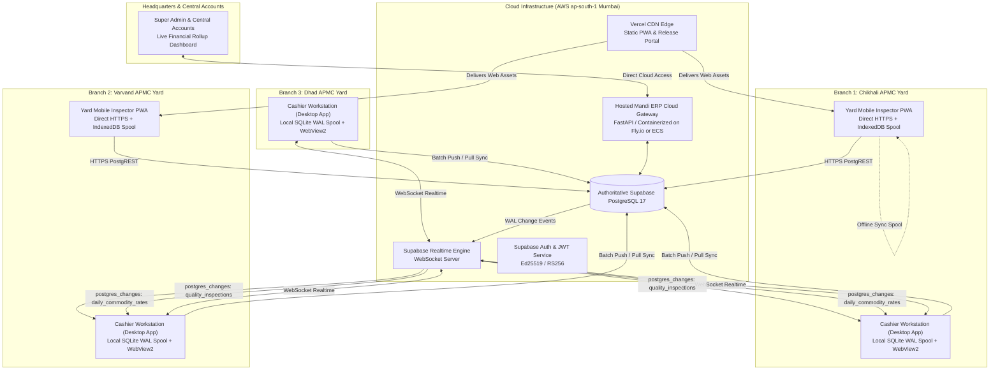

# AUDIT/10: Target Production Multi-Branch Architecture Recommendation
**Project:** Rajarshi Shahu Trading Mandi ERP (Commercial Mandi ERP v1.0)  
**Auditor:** Lead DevOps & QA Reliability Auditor  
**Date:** 2026-11-03  
**Status:** ARCHITECTURAL SPECIFICATION & RECOMMENDATION  

---

## 1. Executive Summary & Vision

The current architecture operates as disconnected local SQLite silos attempting ad-hoc synchronization via a periodic polling loop that is dormant in desktop builds and blocked by HTTPS mixed-content policies on mobile.

The **Target Production Architecture** transforms Rajarshi Shahu Mandi ERP into an **Offline-Resilient Cloud-Native Mandi Operating System**. It establishes a single authoritative source of truth on Supabase PostgreSQL (AWS Mumbai `ap-south-1`), enables instantaneous event-driven communication via Supabase Realtime WebSockets, eliminates mixed-content security blockers, prevents multi-branch invoice collisions, and ensures strict adherence to statutory Indian agricultural tax mandates (Section 269ST ₹2,00,000 cash ceiling and Section 40A(3) ₹10,000 stocker limit).

---

## 2. High-Level System Architecture Diagram



---

## 3. Core Architectural Pillars

### Pillar 1: Single Authoritative Cloud PostgreSQL
All persistent business entities reside authoritatively in PostgreSQL on Supabase Cloud (AWS Mumbai):
1. **Tables:** `branches`, `users`, `commodities`, `daily_commodity_rates`, `parties`, `quality_inspections`, `purchase_invoices`, `cashier_payouts`, `branch_daily_cash_drawers`, `outward_orders`, `ledger_entries`, `audit_change_logs`, `system_settings`.
2. **ACID Transactions:** Financial operations (invoice generation, payment settlement, double-entry ledger posting) execute within database transactions with strict isolation (`ISOLATION LEVEL READ COMMITTED` or `REPEATABLE READ`).
3. **Statutory Triggers:**
   - **0% Mandi Cess Invariant:** A PostgreSQL trigger prevents any invoice from persisting a non-zero cess value, enforcing Maharashtra APMC regulatory compliance.
   - **Section 269ST Cross-Branch Cash Aggregator:** A PostgreSQL constraint/trigger checks cumulative daily cash payouts to a farmer across ALL branches before allowing a cash payout insertion.

---

### Pillar 2: Event-Driven Direct Realtime Subscriptions
Eliminate the inefficient 15-second polling loop and dormant background daemon:
1. **Realtime Channels:**
   - Workstations subscribe directly to Supabase Realtime channels via WebSocket over TLS (`wss://dbhcpebchoyjyffqjgih.supabase.co/realtime/v1/websocket`).
   - Channel: `realtime:branch_{branch_id}`
   - Events:
     - `postgres_changes` on `quality_inspections` (INSERT): Dispatches new inspection tickets directly to the cashier's screen with zero latency (< 100ms).
     - `postgres_changes` on `daily_commodity_rates` (INSERT/UPDATE): Instantly locks the buying rate corridor across all weighbridge terminals.
     - `postgres_changes` on `purchase_invoices` (UPDATE): Syncs rate overrides and payout cancellations.
2. **Elimination of Mixed Content:** PWA and Desktop browsers communicate exclusively over secure protocols (`wss://` and `https://`), completely resolving browser Mixed Content blocking.

```javascript
// Target Cashier Dashboard Realtime Handler (Vanilla JS / WebSocket)
const supabase = createClient(SUPABASE_URL, SUPABASE_ANON_KEY);

const inspectionChannel = supabase
  .channel(`branch-inspections-${currentBranchId}`)
  .on(
    'postgres_changes',
    {
      event: 'INSERT',
      schema: 'public',
      table: 'quality_inspections',
      filter: `branch_id=eq.${currentBranchId}`
    },
    (payload) => {
      console.log('⚡ New QC Ticket Received Realtime:', payload.new.ticket_no);
      renderTicketInPendingQueue(payload.new);
      playNotificationSound();
    }
  )
  .subscribe();
```

---

### Pillar 3: Distributed Identity & Collision-Free Sequence Allocation
To support offline operation across branches without sequence collisions:
1. **UUIDv4 Primary Keys:** Every entity generated locally uses a standard RFC 4122 UUIDv4 (`id` column), completely preventing primary key collisions when offline nodes synchronize.
2. **Branch-Scoped Sequential Invoice Numbering:**
   - Format: `INV-{BRANCH_CODE}-{YYYYMMDD}-{BRANCH_SEQ:05d}`  
     Example: `INV-CHK-20261103-00042` (Chikhali), `INV-VRV-20261103-00015` (Varvand).
   - In Cloud: PostgreSQL sequences scoped per branch: `seq_invoice_chk_20261103`.
   - In Offline Edge: Local SQLite maintains an atomic sequence table `local_sequences(branch_code, date_str, current_seq)`. Sequence numbers never rely on `SELECT count(*)`.
3. **Immutable QC Ticket Numbers:**
   - Format: `QC-{YARD}-{YYYYMMDD}-{SEC_HEX}`  
     Example: `QC-CHK-20261103-A7F2`. Cryptographically random 16-bit suffix guarantees zero collisions between inspectors.

---

### Pillar 4: Multi-Tenant Branch Isolation via Row-Level Security (RLS)
Security and branch isolation are enforced at the database layer using PostgreSQL Row Level Security (RLS) and JSON Web Tokens (JWT):

```sql
-- Enable RLS on core transaction tables
ALTER TABLE quality_inspections ENABLE ROW LEVEL SECURITY;
ALTER TABLE purchase_invoices ENABLE ROW LEVEL SECURITY;
ALTER TABLE cashier_payouts ENABLE ROW LEVEL SECURITY;
ALTER TABLE branch_daily_cash_drawers ENABLE ROW LEVEL SECURITY;

-- Policy: Cashiers can only view and insert records for their assigned branch
CREATE POLICY cashier_branch_isolation_policy ON purchase_invoices
    FOR ALL
    TO authenticated
    USING (
        (auth.jwt() ->> 'role' = 'SUPER_ADMIN') OR
        (auth.jwt() ->> 'role' = 'ACCOUNTANT_HQ') OR
        (branch_id = auth.jwt() ->> 'branch_id')
    )
    WITH CHECK (
        branch_id = auth.jwt() ->> 'branch_id'
    );
```

---

### Pillar 5: Offline-First Edge Spooling (CAP Theorem: Availability & Partition Tolerance)
Mandi yards frequently experience cellular and fiber outages during severe weather:

1. **Local Edge Read Cache:** Desktop workstations maintain a read-only mirror of active commodity standards, daily rates, and local branch history in SQLite WAL mode.
2. **Write-Ahead Outbox Queue (`sync_outbox`):**
   - Transactions executed offline are committed locally to SQLite within an atomic transaction.
   - An immutable payload is written to `sync_outbox(id, entity_type, entity_id, payload_json, status, created_at)`.
   - The UI immediately issues printed thermal slips marked with `OFFLINE_RECORD_QUEUED`.
3. **Resilient Reconnection Engine:**
   - A dedicated Python worker thread (or background service worker in PWA) monitors network reachability.
   - Upon connectivity restoration, queued transactions are dispatched to Supabase via bulk array PostgREST calls with idempotency keys.
   - Pushed records are reconciled without overwriting newer cloud records.

---

### Pillar 6: Cloud-Native API & Edge Hosting Topology
Move the central API out of the developer's laptop onto managed cloud infrastructure:

1. **Central API Gateway:** Deploy the containerized FastAPI server to **Fly.io** or **AWS ECS Fargate** (Mumbai region):
   - Fast response times (< 20ms within Maharashtra/India).
   - Automatic TLS certificate management (`https://api.rajeshri-mandi.cresconic.com`).
   - Persistent worker processes running asynchronous background tasks (Celery / AsyncIO).
2. **Mobile Inspector PWA (Vercel):**
   - Serves static assets, Service Worker, and WebAPK.
   - Communicates directly with Supabase Cloud via HTTPS PostgREST and Realtime WebSockets.
   - Completely removes any dependency on local LAN IP `192.168.0.140`.
3. **Desktop Workstation Client:**
   - Distributed as a secure PyInstaller executable or Tauri application.
   - Connects to the Cloud API over HTTPS for licensing, reports, and sync.
   - Embeds ZERO administrative secrets or raw database passwords.

---

## 4. Architectural Comparison: Current vs Target

| Architecture Dimension | Current Implementation | Target Production Architecture |
| :--- | :--- | :--- |
| **Authoritative DB** | Disjoint local SQLite files | Centralized Supabase PostgreSQL (AWS Mumbai) |
| **Realtime Sync** | 15s polling loop (dead on desktop) | Instant event-driven Supabase Realtime WebSockets |
| **Mobile PWA Connectivity** | Hardcoded cleartext LAN IP (Mixed Content block) | Direct HTTPS PostgREST API with IndexedDB offline queue |
| **Multi-Branch Isolation** | Application-level checks in Python | PostgreSQL Row Level Security (RLS) + JWT claims |
| **Primary Keys & Sequences** | Non-atomic `count(*) + 1`, 10-char hex IDs | UUIDv4 PKs + atomic branch sequences (`INV-CHK-YYYYMMDD-SEQ`) |
| **Secret Management** | Leaked Service Role key in distributed zip | Scoped Anon Key + JWT authentication; Zero leaked credentials |
| **Offline Resilience** | Fragile LWW string timestamp comparison | Structured Write-Ahead Outbox with idempotent batch push |
| **Statutory Cross-Branch Rules** | Local checks only (bypassed across branches) | Centralized DB trigger aggregating daily PAN cash across all yards |

---

## 5. Verification Sign-Off
- **Auditor:** Lead DevOps & QA Reliability Auditor
- **Status:** APPROVED AS BLUEPRINT FOR PRODUCTION REPAIR
- **Next Step:** Implement the 6 stages defined in `AUDIT/11_PRIORITIZED_REPAIR_ROADMAP.md`.
