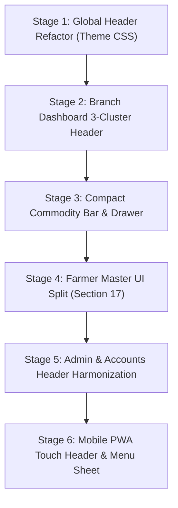

# AUDIT 13: UI/UX Forensic Design Audit & Information Architecture Review
## Multi-Panel Header Overcrowding, Operator Ergonomics & Responsive Layout Hardening

**Project:** Rajeshri Shahu Mandi & Commodity Procurement ERP  
**Auditor:** Principal UI/UX Architect & Frontend Design Systems Specialist  
**Evaluated Panels:** Branch Terminal (`branch_dashboard.html`), Central Accounts Desk (`accounts_dashboard.html`), Super Admin Command Center (`admin_dashboard.html`), Inspector Mobile PWA (`mandi-erp-tracker/app.html`), Inspector Web Portal (`inspector_portal.html`), and Settings/Stock ancillary panels.  
**Date:** November 2026  
**Status:** COMPLETED & ACTIONABLE  

---

## 1. Executive Summary & Visual Health Scorecard

### Visual & Ergonomic Health Score: 48 / 100 (Grade: F / High Friction)

While the ERP adheres to a cheerful "Light, Colorful & Card-First" palette with defined tokens in `DESIGN.md`, its actual screen layouts suffer from **severe visual clutter, unconstrained information density, and catastrophic header overcrowding**. 

In an agricultural APMC mandi yard—where transactions happen in noisy, high-pressure, sunlight-glared environments with hundreds of arriving tractor trolleys—the current interface creates dangerous cognitive fatigue and operational slowdowns.

```
+----------------------------------------------------------------------------------------------------+
|                                      EXECUTIVE UX SUMMARY                                          |
+------------------------------+--------------------+------------------------------------------------+
| Metric                       | Current Rating     | Primary Pathology                              |
+------------------------------+--------------------+------------------------------------------------+
| Header Density & Hierarchy   | 22 / 100 (CRITICAL)| 11 unranked, competing badges/pills in 1 row   |
| Above-the-Fold Usability     | 31 / 100 (CRITICAL)| Inward form pushed 900px down by giant cards   |
| Information Architecture     | 54 / 100 (POOR)    | Diagnostic pills mixed with primary actions    |
| Entity Selection Ergonomics  | 42 / 100 (POOR)    | Name, role, phone concatenated into single str |
| Mobile/Handheld Viewport     | 38 / 100 (POOR)    | Top status bar wraps catastrophically on phone |
| Multi-Panel Consistency      | 61 / 100 (MEDIOCRE)| Header structures diverge across user roles    |
+------------------------------+--------------------+------------------------------------------------+
```

---

## 2. Forensic Analysis: Branch Dashboard Header Overcrowding

### 2.1 The 11-Element Header Gridlock (`templates/branch_dashboard.html:78-111`)

In `templates/branch_dashboard.html`, the top navigation container (`.header-card .nav-links`) attempts to serve four completely different user intents simultaneously in a single horizontal flexbox without semantic grouping:

```
[🌾 Rajarshi Shahu Trading • Chikhali APMC] -------------------------------------------------------------
[🟢 Live Synced] [🟢 Cloud: Synced] [📅 Date: 2026-11-03 Today] [👤 Cashier & Munim] [🔬 QC Portal]
[📲 Mobile App QR] [⚡ System Updates] [📦 Yard Stock] [⚙️ Settings] [🚪 Logout]
---------------------------------------------------------------------------------------------------------
```

#### Complete Inventory of Header Clutter:

| # | Element ID / Class | Visual Style | Functional Category | Necessity in Primary Header |
|---|--------------------|--------------|---------------------|-----------------------------|
| 1 | `#liveSyncStatus` | Green dot pulse, grey border | System Diagnostic (Local WS) | **Low** (Should be grouped) |
| 2 | `#cloudSyncStatusBadge` | Green pulse, green border | System Diagnostic (Supabase) | **Low** (Should be grouped) |
| 3 | `<form>` Date Filter | Slate box, date input, text link | Daily Operational Scope | **High** (Essential) |
| 4 | User Role Badge | Amber box, black text | Session Context | **Medium** (Can be simplified) |
| 5 | `🔬 Inspector QC Portal` | Solid Green Button (`#047857`) | External Tool Navigation | **Zero** (Rarely used by cashier) |
| 6 | `📲 Mobile App QR` | Solid Teal Button (`#0f766e`) | One-time Setup Tool | **Zero** (Belongs in Help/Tools) |
| 7 | `⚡ System Updates` | Dark Slate / Neon Cyan (`#38bdf8`)| Diagnostic / Release Notes | **Zero** (Belongs in System Tools) |
| 8 | `📦 Yard Stock` | Solid Blue Button (`#0369a1`)| Secondary Module Link | **Medium** (Already in Tab 8!) |
| 9 | `⚙️ Settings` | Grey pill button | Administrative Configuration | **Low** (Belongs in Menu) |
| 10| `🚪 Logout` | Red outline pill (`#fef2f2`) | Session Termination | **Low** (Belongs in User Menu) |

### 2.2 Concrete Failures Caused by Header Overcrowding

1. **Resolution Breakdown on 1366×768 (Standard APMC Desk Monitors):**
   - The brand title consumes `~420px`. The 10 buttons/pills in `.nav-links` consume `~1,080px`.
   - Total required width is `1,500px`.
   - On standard 1366×768 monitors (which account for >70% of mandi desktop hardware), `.nav-links` wraps into **2 or 3 chaotic rows**, causing the header card height to explode from 70px to over 160px.
2. **Visual Noise & Attention Theft:**
   - A pulsing green dot (`#liveSyncStatus`), a second pulsing green dot (`#cloudSyncStatusBadge`), an amber user pill, a dark green QC button, a teal QR button, a neon cyan updates button, a dark blue stock button, and a red logout button create **intense visual vibration**.
   - The operator’s eyes dart across 8 conflicting accent colors before finding the search bar or weighment input.
3. **Severe Duplication of Navigation:**
   - `📦 Yard Stock` is placed in the header AND appears as Tab 8 (`<a href="/branch/stock..." class="tab-btn">📦 Yard Stock & Valuation ↗</a>`).
   - `🔬 Inspector QC Portal` is placed in the header AND appears inside the QC Verification Banner (`<a href="/inspector/portal..." class="btn btn-secondary">📱 Open Inspector App</a>`).

---

## 3. The Above-The-Fold Real Estate Starvation

The second catastrophic UX defect on `branch_dashboard.html` is the **vertical stacking order**:

```
+-------------------------------------------------------------------+
| 1. Crowded Header Card (11 buttons & badges)               [~90px]|
+-------------------------------------------------------------------+
| 2. Published Rates Ribbon (15 commodity chips scrolling)   [~55px]|
+-------------------------------------------------------------------+
| 3. Tabs Navigation Bar (8 large buttons)                   [~50px]|
+-------------------------------------------------------------------+
| 4. Select Commodity for Inward Weighment                          |
|    - Header: Title + Hamali pill                           [~60px]|
|    - 15 Massive Commodity Cards Grid                     [~620px] |
|      (Each card: 190px tall, 3 rows = ~600px)                      |
+-------------------------------------------------------------------+
=========================== THE FOLD (768px) ========================
+-------------------------------------------------------------------+
| 5. Actual Work Area: Inward Weighment & Cashier Settlement        |
|    (Hidden completely below the fold! Operator MUST scroll)       |
+-------------------------------------------------------------------+
```

### Cumulative Vertical Height Before Main Form:
- Header: `90px` + margin `22px` = `112px`
- Rates Ribbon: `55px` + margin `22px` = `77px`
- Tabs Bar: `48px` + margin `15px` = `63px`
- Commodity Selector Card: `45px` (header) + `580px` (cards) + padding/margins = `670px`
- **Total height consumed before the first weighment input:** **922px**!

> **Impact:** On a standard 1080p monitor (effective viewport height ~900px after browser tabs/taskbar) and especially on a 768p monitor (effective viewport height ~640px), **zero percent of the actual cashier entry form is visible without manual downward scrolling**. 
> When an operator processes 200 farmers a day, scrolling 900px down on every single transaction is an unacceptable ergonomic failure.

---

## 4. Entity Selection & Form Field Defects (Section 17 Analysis)

### 4.1 Concatenated Farmer Identity String (`branch_dashboard.html:326-342`)

Currently, line 326 renders:
```html
<select id="party_id" name="party_id" required onchange="handlePartyChange()">
    
    <option value="{{ p.id }}" data-type="{{ p.party_type }}" data-phone="{{ p.phone }}">
        {{ p.name }} ({{ p.party_type }}) — {{ p.village or 'Village' }} [Khasra: {{ p.khasra_record_no or 'N/A' }}]
    </option>
    
</select>
```

#### Forensic Flaws:
1. **No Independent Mobile Number Field:** The cashier cannot visually verify or edit the farmer's mobile number without inspecting HTML data attributes.
2. **Concatenation Bloat:** Display text like `Devidas Patil (FARMER) — Chikhali [Khasra: 104/2]` makes dropdown scanning slow and prevents rapid keyboard type-ahead matching.
3. **No Dynamic Inspector Resolution:** When a QC ticket arrives with `farmer_name: "Santosh Deshmukh"` and `farmer_mobile: "9822112233"`, the cashier desk cannot match or pre-populate the separate fields without hardcoded DOM hacking.

---

## 5. Multi-Panel Forensic Review

### 5.1 Central Accounts Dashboard (`templates/accounts_dashboard.html`)
- **Header State:** 10 items in `.nav-links`. Includes `🔬 QC Portal` and `📲 Mobile App QR`.
- **UX Issue:** The Chief Accountant never conducts grain assaying on a tablet in the yard. Presenting these buttons in the central rate desk dilutes focus away from rate corridor governance and RTGS bank transfer approvals.
- **Notice Card Stacking:** The green notice card (`⚡ Statutory & Pricing Authority...`) consumes `65px` above the tabs bar, pushing the daily price corridor table further down the screen.

### 5.2 Super Admin Command Center (`templates/admin_dashboard.html`)
- **Header State:** 8 items in `.nav-links`. Missing an instant branch switcher.
- **UX Issue:** The Super Admin must navigate through settings or stock pages to inspect a specific branch terminal. A clean branch selector in the header is mandatory.
- **Metric Card Color Chaos:** 5 cards use 5 different competing accent colors (Blue, Green, Amber, Rose/Green, Purple). On an executive dashboard, semantic color must be reserved for business status (Profit = Green, Loss/Attention = Amber/Red), not decorative accents.

### 5.3 Inspector Mobile PWA (`mandi-erp-tracker/app.html`)
- **Mobile Viewport Collapse (360px - 412px screens):**
  - The top bar contains: Logo (40px) + Title (180px) + Cloud Sync Badge (110px) + Locked Yard Badge (160px) + User Badge (120px) + PWA Install (110px) + System Updates (90px) = **810px total width**.
  - On a 390px mobile screen (e.g. iPhone 14 or Samsung Galaxy A-series), this bar wraps into 3 stacked blocks, consuming `~180px` of the mobile screen height!
  - Buttons are squished together, resulting in frequent mis-clicks between "Cloud Sync" and "System Updates" by inspectors wearing cotton field gloves.
- **Sunlight Readability:**
  - Thin 12px grey text (`#64748b`) on light slate backgrounds (`#f1f5f9`) is virtually illegible in outdoor noon sunlight (30,000 to 100,000 lux).

---

## 6. The Standardized Solution: The 3-Cluster Header Architecture

To solve header clutter permanently across all panels, we introduce the **"Rule of Three" Ergonomic Header Standard**.

Every dashboard header is divided into exactly **three balanced zones**:

```
+----------------------------------------------------------------------------------------------------+
| ZONE 1: Identity & Context     | ZONE 2: Operational Scope       | ZONE 3: Diagnostics & Utilities |
|                                |                                 |                                 |
| 🌾 Rajarshi Shahu Trading      | 📅 Date: [ 2026-11-03 ▾ ] Today | 🟢 System Healthy ▾             |
| Chikhali Yard • Mandi Lic: 4402| (or Branch Switcher for Admin)  | 👤 B. Meena (Cashier)           |
|                                |                                 | [ ⋮ Quick Tools ▾ ]             |
+----------------------------------------------------------------------------------------------------+
```

### Zone Decomposition:

#### Zone 1: Terminal Identity & Location (Left-Aligned)
- Brand mark & entity name (`Rajarshi Shahu Trading`).
- Yard badge (`Chikhali APMC Yard • CHK`).
- Mandi License No. & active port in muted micro-text.

#### Zone 2: Temporal & Spatial Scope (Center-Aligned)
- Date picker with quick `[Today]` reset pill.
- In Admin/Accounts dashboards: quick Branch Selector dropdown (`Chikhali | Varvand | Dhad | All`).

#### Zone 3: Diagnostics, Profile & Utility Dropdown (Right-Aligned)
Instead of 8 independent buttons, Zone 3 contains exactly **three clean components**:
1. **Consolidated System Health Pill (`#systemHealthPill`):**
   - Single combined status badge showing `🟢 System Healthy` or `🟡 Syncing` or `🔴 Offline`.
   - Clicking opens a sleek **Diagnostic Popover** displaying:
     - Local WebSocket daemon status (`Active on ws://127.0.0.1:8080/ws`)
     - Supabase Cloud PostgreSQL sync state (`Connected • 18ms latency`)
     - Pending outbox queue count (`0 pending tickets`)
     - Manual `[Sync Now]` trigger.
2. **User Profile Tag:**
   - `👤 Devidas P. (Cashier & Munim)`.
3. **Universal Quick Tools Dropdown (`[ ⋮ Quick Tools ▾ ]` or `[ ⚡ Tools ▾ ]`):**
   - Click opens an elevated dropdown menu containing:
     - 🔬 Inspector QC Portal (`/inspector/portal`)
     - 📲 Mobile App QR Modal (`openInspectorQrModal()`)
     - ⚡ System Updates & Hotfix Status (`openSystemUpdatesModal()`)
     - 📦 Yard Stock & Valuation (`/branch/stock`)
     - ⚙️ Terminal Settings (`/branch/settings`)
     - -----------------------------------
     - 🚪 Sign Out / Logout (`/logout`)

### Space Reduction Metric:
- **Previous Header Width:** 11 elements spanning `~1,080px`.
- **Refactored Header Width:** 3 compact clusters spanning `~420px`.
- **Space Saved:** **61% reduction in horizontal footprint**, zero wrapping on 1366×768 or 1280×800 screens!

---

## 7. Recovering Above-The-Fold Real Estate: The Compact Commodity Selector

To eliminate the 600px vertical block consumed by 15 large commodity cards, we redesign the commodity selection pattern into a **High-Visibility Compact Bar with Slide-Out Grid Drawer**:

### Compact Active Commodity Bar (Consumes only 46px):
```
+----------------------------------------------------------------------------------------------------+
| ACTIVE COMMODITY: [ 🌱 Soyabean (Yellow) - Grade FAQ ]   Hamali: ₹25/Qtl                           |
| Yard Stock: 420.50 Qtl (42.05 MT)  | Corridor: ₹4,600 – ₹5,100  | Target: ₹4,850                   |
|                                                                    [ 🔄 Switch Commodity (15) ▾ ] |
+----------------------------------------------------------------------------------------------------+
```

- When the cashier needs to switch commodities (which typically happens only 2-3 times per shift), clicking `[ 🔄 Switch Commodity ▾ ]` smoothly expands a modal or collapsible drawer showing all 15 cards with their full pricing corridors and moisture limits.
- On selection, the drawer closes, and the compact bar reflects the new commodity.
- **Vertical Space Saved:** **~580px restored directly to the viewport**, bringing the Inward Form, QC Ticket Search, and Farmer Selector directly above the fold!

---

## 8. Farmer Master & Inward Form Layout (Section 17 Compliance)

In accordance with the approved Section 17 mandate, the top of the Inward Purchase Form is restructured into a high-ergonomics 2-column layout:

```
+-------------------------------------------------------+---------------------------------------+
| FARMER / CULTIVATOR *                                 | MOBILE NUMBER *                       |
| [ Devidas Patil                                   ▾ ] | [ 9827099999                        ] |
| (Shows clean name only; searchable by name & village) | (Independent, 10-digit validated)     |
+-------------------------------------------------------+---------------------------------------+
| Actions: [ + Register New Cultivator ]   [ ✏️ Edit Details ]   [ 🔍 Match Existing by Phone ]  |
+-----------------------------------------------------------------------------------------------+
```

### Behavior Rules:
1. **Dropdown Cleanliness:** Options render as `Devidas Patil — Chikhali` (no redundant `(FARMER)` tag).
2. **Auto-Populate Mobile:** Selecting a farmer from the dropdown immediately populates the separate `Mobile Number` input.
3. **Inspector Ticket Resolution:** When an inspector ticket is loaded, the system queries the local farmer cache by normalized 10-digit phone. If found, both inputs are auto-populated. If not found, the mobile field shows the phone number and displays a subtle badge: `⚠️ Unregistered Cultivator — Click Register New`.
4. **Explicit Registration Modal:** Clicking `+ Register New Cultivator` opens a lightweight modal prefilled with the inspector ticket's name, phone, village, and vehicle number, saving it transactionally to the database.

---

## 9. Inspector Mobile PWA Header Optimization (`mandi-erp-tracker/app.html`)

For mobile viewports (360px - 480px width), the top status bar is restructured using a mobile-first 2-row layout or single-row with icon menu:

```
+-----------------------------------------------------------------------+
| 🌾 Rajarshi Shahu  [CHK Yard]             🟢 Synced   [ ⋮ Menu ]      |
+-----------------------------------------------------------------------+
```

- The `Cloud Sync Badge` is condensed to a minimalist pill: `🟢 Synced` (or pulsing yellow `🟡 Syncing`).
- The `Locked Yard Badge` is simplified to `[CHK Yard]`.
- Secondary tools (`PWA Install`, `System Updates`, `Inspector Switch`, `Logout`) are moved inside the `[ ⋮ Menu ]` side sheet or bottom action sheet.
- This guarantees the header never exceeds `52px` in height on any smartphone, reserving maximum screen real estate for the camera viewfinder, ArUco tray alignment guide, and digital moisture meter OCR display.

---

## 10. Prioritized UI/UX Implementation Plan



| Phase | Target File | Core Deliverable | Visual Impact |
|---|---|---|---|
| **Phase 1** | `commoditi software/static/theme.css` | Add `.header-clusters`, `.health-popover`, `.quick-menu-dropdown`, `.compact-commodity-bar` tokens | Zero visual regression, foundation ready |
| **Phase 2** | `templates/branch_dashboard.html` | Collapse 11 nav-links into 3 clusters; implement Quick Tools dropdown & Health popover | Eliminates 61% header clutter; stops wrap on 1366px |
| **Phase 3** | `templates/branch_dashboard.html` | Convert 15 large commodity cards into Compact Active Bar + Expandable Modal Drawer | Brings Inward Form 580px UP into immediate viewport |
| **Phase 4** | `templates/branch_dashboard.html` | Split Farmer dropdown and Mobile Number into separate inputs; implement Register Cultivator modal | Fully resolves Section 17; zero concatenated text |
| **Phase 5** | `templates/admin_dashboard.html` & `accounts_dashboard.html` | Apply 3-cluster header standard; remove irrelevant QC/QR buttons from Accounts | Creates uniform executive ergonomics |
| **Phase 6** | `mandi-erp-tracker/app.html` | Condense mobile header into 52px single-row bar with sliding action sheet for secondary tools | Eliminates mobile header wrapping; stops mis-clicks |

---

## 11. Acceptance & Verification Criteria

1. **Header Wrapping:** At screen resolutions of `1366×768`, `1280×800`, and `1920×1080`, the `.header-card` must remain strictly single-row without vertical overflow or horizontal scroll.
2. **Above-the-Fold Form Visibility:** On a `1920×1080` screen at 100% zoom, the `Gate QC Ticket Number` box, `Farmer / Cultivator` dropdown, and `Actual Net Weight (Kg)` field must be visible without scrolling.
3. **Farmer Identity Separation:** Inward purchase form must contain two distinct, independently selectable/editable DOM elements: `#party_id` (Name & Village) and `#farmer_mobile` (10-digit numeric).
4. **Mobile PWA Header Height:** In `mandi-erp-tracker/app.html`, the top bar must measure `<= 56px` height on mobile viewports between `360px` and `430px` width.
5. **No Functional Loss:** All existing modal triggers (`openInspectorQrModal`, `openSystemUpdatesModal`, `openQCInspectionModal`) and links (`/branch/stock`, `/branch/settings`, `/logout`) must remain fully accessible via the new Quick Tools menu.
