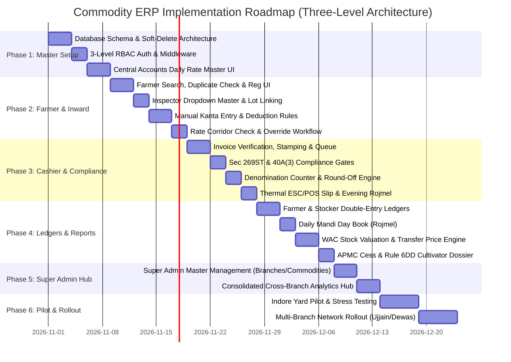

# Full Implementation Plan: Commodity Trading & Mandi ERP
**Three-Level Governance Architecture, Daily Rate Master, Branch Operations & Accounting**

---

## 1. Project Overview & Three-Level Architecture Strategy

This plan defines the end-to-end execution roadmap for the **Commodity Procurement & Mandi Accounting ERP**, structured strictly across **three distinct organizational tiers** with **dedicated login pages, independent panels, and unified management under Super Admin**:

```
                             ┌────────────────────────────────────────────────────────┐
                             │               LEVEL 1: SUPER ADMIN (HQ)                │
                             │  Portal: /admin/login  ->  /admin/dashboard            │
                             │  • Organization-wide Analytics & Executive Dashboard   │
                             │  • Branch & Commodity/Grade Master Administration      │
                             │  • Accountant Account & Security Access Governance     │
                             │  • Consolidated P&L, Margin Analysis & Audit Logs      │
                             └───────────────────────────┬────────────────────────────┘
                                                         │ (Creates & Controls Accounts & Branches)
                             ┌───────────────────────────┴────────────────────────────┐
                             │           LEVEL 2: CENTRAL ACCOUNTS / ACCOUNTANT       │
                             │  Portal: /accounts/login  ->  /accounts/dashboard      │
                             │  • Daily Commodity Min/Max Buying Rate Master          │
                             │  • Sole Authority for Out-of-Range Rate Overrides      │
                             │  • Inspector Dropdown Master List Maintenance          │
                             │  • Full Financial Accounting (Journals, Ledgers, GST)  │
                             │  • Inter-Branch Transfer Pricing & Reconciliations     │
                             └───────────────────────────┬────────────────────────────┘
                                                         │ (Publishes Rates & Approves Overrides)
             ┌───────────────────────────────────────────┼───────────────────────────────────────────┐
             │                                           │                                           │
             ▼                                           ▼                                           ▼
   ┌───────────────────────────┐               ┌───────────────────────────┐               ┌───────────────────────────┐
   │   LEVEL 3: BRANCH 1       │               │   LEVEL 3: BRANCH 2       │               │   LEVEL 3: BRANCH 3       │
   │      (Indore Yard)        │               │      (Ujjain Mandi)       │               │      (Dewas Center)       │
   │  Portal: /branch/login    │               │  Portal: /branch/login    │               │  Portal: /branch/login    │
   ├───────────────────────────┤               ├───────────────────────────┤               ├───────────────────────────┤
   │ • Daily Published Rates   │               │ • Daily Published Rates   │               │ • Daily Published Rates   │
   │ • Farmer Search & Reg     │               │ • Farmer Search & Reg     │               │ • Farmer Search & Reg     │
   │ • Inspector Dropdown      │               │ • Inspector Dropdown      │               │ • Inspector Dropdown      │
   │ • Manual Weighbridge (Kg) │               │ • Manual Weighbridge (Kg) │               │ • Manual Weighbridge (Kg) │
   │ • Inward Parchi (Token)   │               │ • Inward Parchi (Token)   │               │ • Inward Parchi (Token)   │
   │ • Cashier Verify & Payout │               │ • Cashier Verify & Payout │               │ • Cashier Verify & Payout │
   │ • Local Stock & Outward   │               │ • Local Stock & Outward   │               │ • Local Stock & Outward   │
   │ • Daily Drawer (Rojmel)   │               │ • Daily Drawer (Rojmel)   │               │ • Daily Drawer (Rojmel)   │
   └───────────────────────────┘               └───────────────────────────┘               └───────────────────────────┘
```

---

## 2. Dedicated Login Portals & Panel Separation

To ensure absolute operational clarity and security, the software provides **three distinct login interfaces and dashboards**, each customized for its operational environment:

```
┌─────────────────────────────────────────────────────────────────────────────────────────────┐
│                            THREE DISTINCT PORTALS & INTERFACES                              │
├──────────────────────┬────────────────────────────┬─────────────────────────────────────────┤
│ Portal               │ Route / URL                │ Visual Design & Operational Purpose     │
├──────────────────────┼────────────────────────────┼─────────────────────────────────────────┤
│ **Super Admin**      │ `/admin/login`             │ **Executive Command Center:** Dark slate│
│                      │ `-> /admin/dashboard`      │ theme, macro KPI summaries, cross-branch│
│                      │                            │ analytics, branch/commodity management. │
├──────────────────────┼────────────────────────────┼─────────────────────────────────────────┤
│ **Central Accounts** │ `/accounts/login`          │ **Financial Control Room:** Dense audit │
│                      │ `-> /accounts/dashboard`   │ layout, rate master boards, voucher entry│
│                      │                            │ grids, inspector master, override queue.│
├──────────────────────┼────────────────────────────┼─────────────────────────────────────────┤
│ **Branch Dashboard** │ `/branch/login`            │ **Yard Touch/Keypad Terminal:** Clean,  │
│                      │ `-> /branch/dashboard`     │ high-contrast, large text, fast entry,  │
│                      │                            │ zero financial distraction, 80mm print. │
└──────────────────────┴────────────────────────────┴─────────────────────────────────────────┘
```

### How Super Admin Manages the Entire Platform:
1. **Accountant Account Governance:** Super Admin creates Central Accountant logins (`/admin/users/accountant`), sets permission scopes, and can revoke or reset credentials at any time.
2. **Branch Management:** Super Admin creates branches (`/admin/branches`), sets mandi license details, assigns location codes, and deactivates branches (`is_active = FALSE`).
3. **Master Data Authority:** Super Admin defines the master list of commodities (Wheat, Soyabean, Chana, Mustard), applicable quality grades (*Super, FAQ, Under-Grade*), and units of measurement.
4. **Audit & Impersonation:** Super Admin has read-only drill-down access into any branch's live invoices or accountant ledgers to investigate operational bottlenecks.

### Port Configuration & Deployment Network Binding:
- **Default Web Server Port:** **`8080`** (`http://127.0.0.1:8080`)
- **Port Conflict Safeguard:** Port 8000 is occupied by the host system's restaurant application (`PID 7724`); the commodity ERP binds strictly to port `8080`.
- **Local Network / Multi-Branch Binding:** Binds to `0.0.0.0:8080` so all 3 branch counter PCs on the local network/VPN can connect seamlessly.
- **Configurability:** Fully configurable via the `PORT` environment variable (defaults to `8080`).

---

## 3. Three-Level Role & Permission Specifications

### Level 1: Super Admin (Executive & Organization Management)
- **Scope:** Organization-wide, cross-branch visibility and structural administration.
- **Core Screen Ownership & Capabilities:**
  1. **Executive Dashboard:** Live organization-wide inward/outward MT, gross disbursement value, cash vs. bank payout split, aggregate godown inventory, and net margin estimates.
  2. **Accountant Account Administration:** Create, configure, manage access keys, reset passwords, and deactivate Central Accountant accounts.
  3. **Branch Master Management:** Add new branches/yards, edit branch license/address details, and deactivate branches (`is_active = FALSE`). Deactivation preserves complete historical transactions and ledgers.
  4. **Commodity & Grade Master:** Add, update, and deactivate commodities, quality grades, and units of measurement.
  5. **Financial Reconciliation & Exception Monitoring:** View all branch price override requests, audit trails, cashier float variances, and consolidated Profit & Loss reports.
  6. **Explicit Boundary:** Does **not** approve day-to-day rate overrides (exclusive responsibility of Central Accounts).

### Level 2: Central Accounts / Accountant (Financial Control & Rate Authority)
- **Scope:** Financial integrity, statutory compliance, rate governance, and company-wide bookkeeping.
- **Core Screen Ownership & Capabilities:**
  1. **Daily Price Master (Rate Corridor Board):** Sets daily Min, Target, and Max buying rates per commodity and grade by 09:00 AM. Rates can be published globally or customized per branch based on local spot mandi conditions.
  2. **Sole Rate Override Authority:** The **only** role authorized to approve or reject branch requests for purchasing outside the active daily price corridor. Requires an immutable justification note and logs `override_by_accountant_id` and timestamp.
  3. **Inspector Master List Maintenance:** Enters and maintains the authorized names and IDs of branch quality inspectors for the branch inward dropdown menu.
  4. **Inter-Branch Transfer Pricing:** Configures internal transfer prices for inter-branch grain dispatches and audits transfer markups.
  5. **Full Accounting Workflows:** Maintain Double-Entry General Ledger, Journal Vouchers, Cash Book, Bank Book, Bank Reconciliation Statements (BRS), and Operating Expenses.
  6. **Branch Transaction Review:** Audit branch purchase bills, unpaid farmer balances, stocker B2B bills, GST input tax credits (GSTR-2B), and Section 194Q TDS deductions.
  7. **Explicit Boundary:** **No authority** to create/delete branches or manage accountant accounts.

### Level 3: Branch Dashboard (Local Yard Operations)
- **Scope:** Fast, high-throughput, branch-scoped operational interface.
- **Core Screen Ownership & Capabilities:**
  1. **Daily Mandi Rates View:** Real-time display of active HQ-published rates and approved corridors for the day.
  2. **Farmer Search & Registration:** Fast lookup by phone, Aadhaar, name, or village with duplicate detection. Inline registration capturing cultivator land records (*Khasra* number for Income Tax Rule 6DD defense).
  3. **Quality Inspector Selection & Weighment Entry:**
     - Select inspector from the **pre-approved dropdown** (populated by Central Accountant).
     - Record assigned grade, physical quality remarks, and negotiated rate.
     - Input manual gross and tare weights from external weighbridges (*Dharamkanta*), with external slip number, kanta name, and **optional slip photo**.
     - Automated deduction calculations (bag tare, moisture excess, karda, hamali, tulai, advance loan recovery).
  4. **Invoice Generation & Token Issuance:** Issue unique invoice/parchi with optional QR/barcode.
  5. **Cashier Verification & Payment:** Verify physical invoice, record inspection stamp (`VERIFIED`), enforce Section 269ST (₹2L daily limit) and Section 40A(3), disburse cash with currency note denomination tally or record bank transfer, apply rupee cash rounding, and mark invoice `PAID`.
  6. **Stock Visibility & Outward Dispatch:** View local godown stock balance (bags and quintals) and record outward sales or inter-branch transfers at the specified transfer price.
  7. **Daily Branch Summary (Rojmel):** Evening cash drawer reconciliation comparing calculated cash with counted physical notes.
  8. **Explicit Boundary:** **No access** to consolidated financial analytics, other branches' drawers, or master data creation.

---

## 4. Role-Permission Matrix

| Action / Capability | Super Admin (Level 1) | Central Accounts (Level 2) | Branch Operator / Cashier (Level 3) |
| :--- | :---: | :---: | :---: |
| **Organization Consolidated Dashboard** | **Full Access** | Read-Only Summary | **Blocked** |
| **Manage Accountant Accounts** | **Full Access** | **Blocked** | **Blocked** |
| **Add / Edit / Deactivate Branches** | **Full Access** (`is_active = FALSE`) | **Blocked** | **Blocked** |
| **Add / Edit / Deactivate Commodities & Grades** | **Full Access** (`is_active = FALSE`) | **Blocked** | **Blocked** |
| **Manage Inspector Master Dropdown List** | View Only | **Full Access** | Read-Only (Dropdown in Form) |
| **Set Daily Min/Max Buying Rates** | View / Read | **Full Access** | Read-Only (Today's Rates) |
| **Approve Out-of-Range Rate Overrides** | View Audit Log | **Sole Authority** | Request Only |
| **Inward Purchase Entry & Calculations** | View Only | View All Branches | **Full Access (Own Branch)** |
| **Cashier Verification & Payout Disbursement**| View Audits | View Audits | **Full Access (Own Branch)** |
| **Daily Drawer Reconciliation (Rojmel)** | View All Branches | Audit All Branches | **Execute (Own Branch)** |
| **Double-Entry General Ledger & Journals** | View All | **Full Access** | **Blocked** |
| **Stock Outward Dispatch Entry** | View All | View All | **Full Access (Own Branch)** |
| **Consolidated Profit & Loss Reporting** | **Full Access** | **Full Access** | **Blocked** |

*Backend Enforcement:* All endpoints validate both `user.role` and `user.branch_id` via dependency injection middleware. Branch users attempting to query other branches receive `403 Forbidden`.

---

## 5. Business Workflow & Transaction Execution (Steps 1 to 9)

```mermaid
sequenceDiagram
    autonumber
    actor AC as Central Accounts (Level 2)
    actor OP as Branch Operator (Level 3)
    actor CA as Branch Cashier (Level 3)
    participant DB as Backend & Ledger Engine
    
    AC->>DB: 1. Set Daily Rate Corridor & Maintain Inspector Dropdown Master
    OP->>DB: 2. Search Farmer (Phone/Aadhaar); Register if New (Khasra & Duplicate Check)
    OP->>DB: 3. Select Inspector from Dropdown, Assign Grade & Input Negotiated Rate
    OP->>DB: 4. Enter External Weighbridge Data (Gross/Tare/Bags; Photo Optional)
    DB->>DB: 5. Validate Rate against HQ Corridor. If Out-of-Range -> Hold for Central Accounts
    AC->>DB: 5a. Central Accounts Approves Override with Mandatory Reason
    DB->>DB: 6. Calculate Deductions (Tare, Nami, Karda, Hamali, Advance Loan & Interest)
    DB->>OP: 7. Generate Purchase Invoice / Parchi (Unique Token ID + QR Code)
    CA->>DB: 8. Scan Token, Verify Slip, Record Stamp, Check Sec 269ST, Round Cash, Payout
    DB->>DB: 9. Atomically Post Farmer Ledger, Stock Inward, Cash Drawer & General Ledger
```

### Detailed Operational Specifications:

#### Step 1: Daily Rate Master & Inspector Setup (Central Accounts)
- Published daily by Central Accounts before 09:00 AM.
- Defines `min_rate_per_qtl`, `target_rate_per_qtl`, and `max_rate_per_qtl` by commodity, grade, date, and branch.
- Central Accounts also maintains the branch **Quality Inspector Master List**, populating the dropdown options available at the branch inward desk.

#### Step 2: Farmer Search, Duplicate Prevention & Registration
- Multi-attribute search indexed on: Mobile phone (10-digit primary key), Aadhaar, Name, and Village.
- Duplicate detection blocks identical phone numbers and Aadhaar numbers; warns on identical names in the same village.
- Captures legal name, phone, village, *Khasra* land record number (Income Tax Rule 6DD compliance), Aadhaar/PAN, and bank details.

#### Step 3: Inspector Selection & Manual Lot Appraisal
- Operator selects the physical quality inspector from the **pre-approved dropdown** (populated by Central Accounts).
- Physical sampling and grading are strictly manual.
- Operator enters assigned grade (`SUPER`, `FAQ`, `UNDER_GRADE`, `RAIN_DAMAGED`), physical quality remarks, and negotiated rate.

#### Step 4: Purchase Entry, Actual Weight & Inspector Rate Review
- Operator inputs actual weights from the external weighbridge (*Dharamkanta*).
- Captures external kanta name, external slip number, vehicle number, gross kg, tare kg, and bag count.
- **Photo Upload:** Uploading a photo of the external weighment slip is **optional**; slip number and kanta name are mandatory.
- Automated sanity checks flag abnormal tare ratios ($>60\%$ or $<15\%$) or irregular average bag weights ($<35\text{ kg}$ or $>110\text{ kg}$).

#### Step 5: Rate Corridor Validation & Central Accounts Approval
- If proposed purchase rate is within daily [Min, Max], invoice submits immediately.
- If out of bounds: Invoice status shifts to `PENDING_APPROVAL`.
- **Sole Approval Authority:** The Central Accounts desk receives a push notification and reviews the lot details. Central Accounts approves or rejects with a mandatory reason note (`override_reason`).

#### Step 6: Configurable Weight & Deduction Engine
- **Bag Tare:** HDPE poly sack default 0.5 kg; Jute sack default 1.0 kg; Loose 0.0 kg; or sampled tare override.
- **Moisture Cut (*Nami*):** Excess moisture over standard baseline ($M_{\text{actual}} - M_{\text{std}}$) deducted from uncleaned produce weight.
- **Karda / Dust Cut:** Refraction percentage deducted from uncleaned produce weight.
- **Net Quintals:** Derived to 4 decimal places. Gross amount calculated as $\text{Net Quintals} \times \text{Approved Rate}$.
- **Approved Handling & Mandi Deductions:** Hamali, Tulai, Silai, and Mandi Cess (configured per branch rules).
- **Advance Loan Recovery:** Deducts outstanding principal advance + accrued interest ($\frac{A \times R \times D}{365}$).

#### Step 7: Purchase Invoice / Parchi Generation
- Generates a unique, non-repeating invoice number (`[BRANCH]-[YYYYMMDD]-[SEQ]`).
- Status set to `ISSUED_UNVERIFIED`. Prints 80mm thermal parchi with barcode/QR.

#### Step 8: Cashier Verification, Stamping & Payout
- Cashier scans barcode/QR to load the invoice.
- Records physical inspection stamp (`verified_by_user_id`, `verified_timestamp`, `stamp_status = 'VERIFIED'`).
- **Section 269ST Check:** Automatically aggregates all cash paid to this farmer across the organization today. If total reaches $\ge ₹2,00,000$, cash is blocked and bank transfer is forced.
- **Section 40A(3) Check:** Hard-blocks cash payments $> ₹10,000$ to registered Stockers.
- **Cash Denomination & Rupee Rounding:**
  - Cashier inputs counts for ₹500, ₹200, ₹100, ₹50, ₹20, and ₹10 notes.
  - **Cash Rounding Rule:** Fractional paisa on cash payouts round up to the nearest integer rupee. The system automatically creates a matching entry in the `Round-Off Account` to balance the ledger.
- **Duplicate Payment Lock:** Payout transitions invoice to `PAID` within an atomic transaction. Database-level unique constraint prevents any duplicate payout.
- **Reprints:** Any reprinted voucher prints a clear watermark: `"DUPLICATE / REPRINT (Copy #N)"`.

#### Step 9: Consistent Synchronized Ledger & Stock Updates
Upon payment confirmation, a single atomic database commit updates:
1. Farmer Ledger (`Sundry Creditors - Farmers`).
2. Commodity Inventory (increasing physical bags and net quintals).
3. Cashier Drawer Float or Bank Current Account.
4. General Ledger double entries.

---

## 6. Stock Valuation, Inter-Branch Transfer Pricing & P&L

### A. Landed Cost Formula
$$\text{Landed Cost per Quintal} = \frac{V_{\text{gross}} + C_{\text{hamali\_inward}} + C_{\text{tulai}} + C_{\text{mandi\_cess}} + C_{\text{freight\_inward}} - D_{\text{quality\_cuts}}}{Q_{\text{net}}}$$

### B. Inventory Valuation Method: Weighted Average Cost (WAC)
Every inward lot recalculates the branch weighted average unit cost:
$$\text{New WAC} = \frac{(\text{Existing Qtl} \times \text{Existing WAC}) + (\text{Inward Qtl} \times \text{Inward Landed Cost})}{\text{Existing Qtl} + \text{Inward Qtl}}$$

### C. Inter-Branch Stock Transfers (Internal Transfer Price - ITP)
When Branch 1 transfers stock to Branch 2 (or a processing mill):
$$\text{Inter-Branch Transfer Price (ITP)} = \text{Originating Branch Landed WAC} + \text{Internal Transfer Markup}$$
- **Originating Branch:** Books an outward stock transfer and records an inter-branch transfer credit.
- **Receiving Branch:** Enters inward stock at the agreed ITP.
- **Consolidated Super Admin Level:** Internal transfer markups are automatically eliminated in consolidated P&L reporting to prevent artificial unrealized profit.

### D. Moisture Shrinkage & Storage Loss (*Karda Loss*)
Physical grain loses moisture during storage. Before generating monthly P&L:
- Stock audit entries record measured shrinkage loss.
- Shrinkage is expensed to `Stock Adjustment / Storage Loss A/c`, adjusting inventory without distorting trading margins.

---

## 7. Data Integrity & Immutability Architecture

1. **Soft Deletion Policy:**
   - Branches, commodities, quality grades, parties, and users possess an `is_active BOOLEAN DEFAULT TRUE` flag.
   - Master data is **never hard deleted**. Deactivating a branch or commodity preserves all past invoices, ledgers, and financial reports intact.
2. **Historical Transaction Immutability:**
   - Invoices snapshot all rates, weight cuts, deductions, and tax values into immutable table columns at the time of issuance.
   - Future changes to HQ daily rates or branch deduction master rules do **not** cascade backwards to alter historical invoices.
3. **Traceable Transactions:**
   - Every invoice, payout, stock movement, and ledger line carries `created_by`, `created_at`, `branch_id`, and a traceable voucher reference ID.

---

## 8. Phased Implementation Roadmap



---

## 9. REST API Specifications (Reflecting Three-Level Access)

```
LEVEL 1: SUPER ADMIN PORTAL (/admin)
  GET    /api/admin/consolidated-stats         -> Organization-wide inward/outward MT, cash, stock & margins
  GET    /api/admin/branches                   -> List all branches (active & inactive)
  POST   /api/admin/branches                   -> Add new branch
  PUT    /api/admin/branches/:id               -> Edit branch or toggle is_active
  GET    /api/admin/commodities                -> List commodities, grades, and units
  POST   /api/admin/commodities                -> Add commodity or quality grade
  PUT    /api/admin/commodities/:id            -> Edit commodity or toggle is_active
  POST   /api/admin/users/accountant           -> Create or deactivate Central Accountant accounts
  GET    /api/admin/audit-logs                 -> System-wide security, rate override, and variance audit trail

LEVEL 2: CENTRAL ACCOUNTS PORTAL (/accounts)
  GET    /api/rates/daily?date=YYYY-MM-DD      -> View daily buying price master
  POST   /api/rates/daily                      -> Set daily Min/Target/Max rates (global or branch-specific)
  GET    /api/accounts/inspectors              -> List active branch quality inspectors
  POST   /api/accounts/inspectors              -> Add/edit inspector names for branch dropdown
  GET    /api/accounts/pending-overrides       -> List pending out-of-corridor purchase rate requests
  POST   /api/accounts/override-decision       -> Sole authority: Approve or Reject rate override with reason
  GET    /api/accounts/ledgers/general         -> Full double-entry General Ledger and Trial Balance
  POST   /api/accounts/journal-voucher         -> Record manual adjustment and expense journal vouchers
  GET    /api/accounts/reports/pnl             -> Weighted Average Cost P&L, Transfer Markup eliminations
  GET    /api/accounts/reports/apmc-cess       -> Monthly APMC Mandi Cess Statement across all branches

LEVEL 3: BRANCH OPERATIONAL DASHBOARD (/branch)
  GET    /api/branch/today-rates               -> View active HQ-published rates for current branch
  GET    /api/branch/inspectors                -> Get active inspector list for form dropdown
  GET    /api/parties/search?q=...             -> Search farmer/stocker by phone, Aadhaar, name, village
  POST   /api/parties/farmer                   -> Register new farmer with duplicate check & Khasra number
  POST   /api/invoices/calculate               -> Preview calculations (gross, deductions, advance, net)
  POST   /api/invoices                         -> Create purchase invoice (Status: ISSUED_UNVERIFIED)
  POST   /api/invoices/:id/request-override    -> Send out-of-range rate request to Central Accounts
  GET    /api/cashier/invoice/:token_or_id     -> Pull invoice details with Sec 269ST compliance status
  POST   /api/cashier/verify-stamp             -> Record physical inspection stamp (Status: VERIFIED)
  POST   /api/cashier/payout                   -> Disburse cash/bank payout with denomination tally & round-off
  GET    /api/cashier/drawer                   -> View current branch cash float and transactions
  POST   /api/cashier/drawer/close             -> Close evening Rojmel with physical note counts & variance
  GET    /api/branch/stock                     -> View branch godown stock in bags and quintals
  POST   /api/branch/stock/outward-transfer    -> Record outward inter-branch transfer at Internal Transfer Price
```

---

## 10. Acceptance Criteria by Phase

1. **Phase 1 (Master Governance):** Central Accounts sets daily min/max rates for Soyabean and Wheat; Branch purchase desk is prohibited from setting or editing master rate limits.
2. **Phase 2 (Inward & Override Gate):** Entering a rate of ₹4,900/Qtl when HQ Max is ₹4,800/Qtl holds the bill in `PENDING_APPROVAL`. Only Central Accounts can approve it; Branch Manager cannot self-approve. Inspector is chosen from Central Accounts' maintained dropdown.
3. **Phase 3 (Cashier Clearance & Rounding):** Paying an invoice of ₹48,650.40 in cash rounds up to ₹48,651.00; system automatically logs ₹0.60 to `Round-Off Account`. Section 269ST blocks any cash payout if total cash to that farmer today exceeds ₹1,99,999.
4. **Phase 4 (Ledger Synchronization & Transfer Price):** Transitioning an invoice to `PAID` updates Farmer Khata, Cashier Drawer, Stock Ledger, and General Ledger simultaneously with zero data inconsistency. Inter-branch transfers post at Internal Transfer Price.
5. **Phase 5 (Super Admin Analytics):** Super Admin sees aggregate metric tons and gross payout across Indore, Ujjain, and Dewas yards in real time. Deactivating a branch retains all historical invoices and ledgers.
