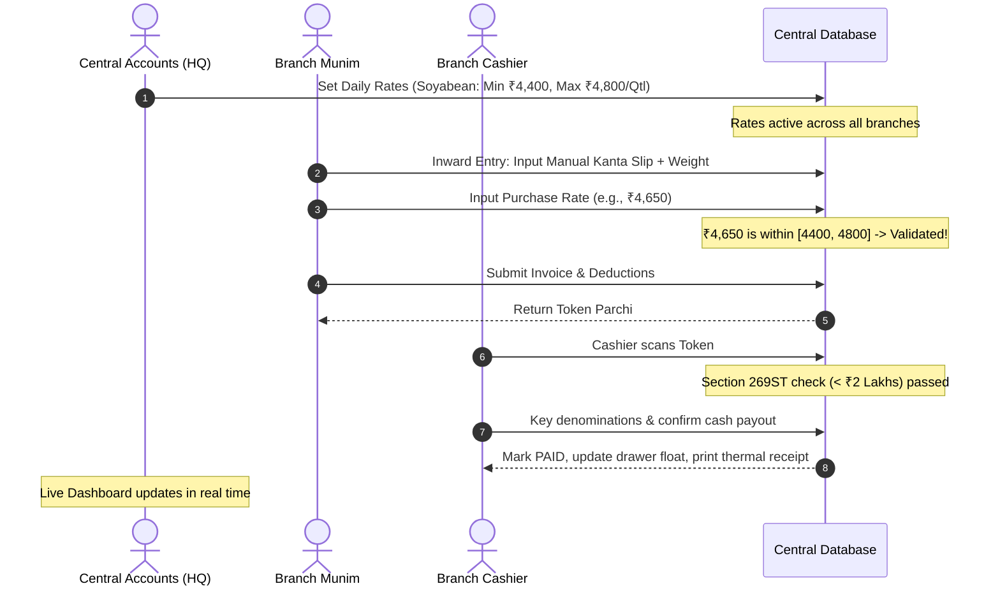

# Multi-Branch & Role-Based Access Control (RBAC) Architecture
**Distributed Procurement Yards, Central Daily Rate Master, and Executive Governance**

---

## 1. Multi-Branch Topology & Scope

Agricultural commodity businesses typically operate across multiple purchasing centers (mandis, private collection yards, and warehouse gates). This architecture supports **3 or more distinct branch locations** managed under a single unified company umbrella.

```
                             ┌──────────────────────────────────────┐
                             │       COMPANY HQ / OWNER PORTAL      │
                             │  (Central Database & Governance Hub) │
                             └──────────────────┬───────────────────┘
                                                │
             ┌──────────────────────────────────┼──────────────────────────────────┐
             │                                  │                                  │
             ▼                                  ▼                                  ▼
   ┌───────────────────┐              ┌───────────────────┐              ┌───────────────────┐
   │    BRANCH 1       │              │    BRANCH 2       │              │    BRANCH 3       │
   │  (Indore Yard)    │              │  (Ujjain Mandi)   │              │  (Dewas Center)   │
   ├───────────────────┤              ├───────────────────┤              ├───────────────────┤
   │ • Purchase Desk   │              │ • Purchase Desk   │              │ • Purchase Desk   │
   │ • Manual Kanta In │              │ • Manual Kanta In │              │ • Manual Kanta In │
   │ • Cashier Counter │              │ • Cashier Counter │              │ • Cashier Counter │
   │ • Local Galla     │              │ • Local Galla     │              │ • Local Galla     │
   └───────────────────┘              └───────────────────┘              └───────────────────┘
```

---

## 2. Dedicated User Roles & Responsibilities

### Role 1: Super Admin (Owner / Executive Dashboard)
* **Access Level:** Unrestricted cross-branch visibility.
* **Core Responsibilities:**
  - Real-time consolidated dashboard showing total metric tons purchased today, gross payout value, cash vs. bank distribution, and live godown stock.
  - Branch-wise comparison: Volume, average purchase rate, cashier cash float, and price override count.
  - Emergency approval for rate overrides requested by branches.
  - Master user management, branch onboarding, and audit log inspection.

---

### Role 2: Central Accounting Desk (HQ Rate Controller & Auditor)
* **Access Level:** Company-wide statutory and pricing controls.
* **Core Responsibilities:**
  - **Daily Commodity Price Master (Min/Max Rate Board):**
    - Sets daily procurement price boundaries before mandis open (09:00 AM) for each commodity and grade.
    - Configures either global rates or branch-specific rates (to reflect local spot market price differences).
  - **Branch Purchase Validation:** The software strictly enforces these bounds at all branch purchase desks.
  - **Ledger Audits & Tax Filing:** Manages B2B stocker reconciliations, GSTR-1 / GSTR-3B summaries, Section 194Q TDS filings, and APMC cess returns.
  - **Inter-Branch Stock Transfers:** Monitors and accounts for commodity movements from branch yards to central processing mills or godowns.

---

### Role 3: Branch Munim (Purchase Inward Desk)
* **Access Level:** Scoped strictly to assigned `branch_id`.
* **Core Responsibilities:**
  - Record commodity inward arrivals from Farmers and Stockers.
  - **Manual Weight Entry:** Type gross and tare weights from external third-party weighbridge (*Dharamkanta*) slips, recording the kanta name and slip number.
  - Select bag type and count; the system calculates bag tare automatically.
  - Input quality inspection metrics (moisture % and karda %); system derives net billable weight.
  - Enter negotiated auction rate:
    - If within daily [Min, Max] set by HQ: Generates inward parchi immediately.
    - If outside bounds: Prompts Munim to submit an override request to HQ.
  - Deducts outstanding farmer advances (*Peshgi*) with accrued interest.
  - Prints 80mm Barcode/QR Token Parchi for the farmer to present to the cashier.

---

### Role 4: Branch Cashier (Payout Counter)
* **Access Level:** Scoped to the branch cashier drawer and payment queue.
* **Core Responsibilities:**
  - Scan or enter Token Number from the weighbridge slip.
  - Instant compliance verification:
    - **Farmer Check:** Checks cumulative cash paid to this farmer today. If new payment + prior cash $\ge ₹2,00,000$, blocks cash payout and forces Bank Transfer under **Section 269ST**.
    - **Stocker Check:** Hard-blocks any cash payout $> ₹10,000$ under **Section 40A(3)**.
  - Enter physical currency note counts (₹500, ₹200, ₹100, etc.) into the denomination counter.
  - Execute payout: Updates cash drawer balance, sets invoice to `PAID`, and prints 80mm thermal receipt with farmer thumb/signature box.
  - Perform daily evening **Rojmel Closing**: Counts physical drawer cash and files variance report.

---

## 3. Daily Price Master Workflow (The HQ Governance Loop)



---

## 4. Branch Data Scoping & Multi-Tenancy Design

Every transactional table includes a non-nullable `branch_id` column:
- All queries executed by Branch Munims and Cashiers append:
  ```sql
  WHERE branch_id = :current_user_branch_id
  ```
- Super Admin and Central Accounts queries execute without the filter to produce cross-branch aggregations:
  ```sql
  SELECT branch_id, SUM(net_quintals) AS total_qtl, SUM(gross_amount) AS total_value
  FROM purchase_invoices
  WHERE invoice_date = :today
  GROUP BY branch_id;
  ```
